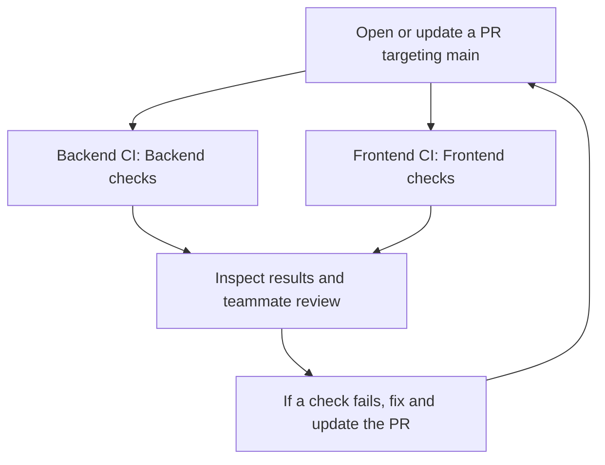

# Roam continuous integration

Continuous integration (CI) automatically checks each proposed change before
review and integration. Roam uses it to catch broken tests, code-style issues,
type errors, and builds consistently, without relying on either developer to
remember every command. A green run is evidence for these checks, not proof that
all product features work or that merging is safe without review.

## From pull request to checks



Both workflows also run on pushes to `main`. There are no path filters: a
frontend-only, backend-only, or documentation change schedules both workflows.
They run independently on Ubuntu 24.04. A failed command fails its job; later
steps normally skip. A new run cancels superseded runs for the same workflow
and PR/ref without cancelling the other workflow.

| Workflow | Job ID / check name | Purpose |
|---|---|---|
| [Backend CI](../.github/workflows/backend-ci.yml) | `backend` / `Backend checks` | Locked Python dependencies, Ruff format/lint, strict mypy, database-free pytest, PostgreSQL/ORM/migration tests |
| [Frontend CI](../.github/workflows/frontend-ci.yml) | `frontend` / `Frontend checks` | Locked npm installation, ESLint, TypeScript, Vitest, production build |

## Reproduce locally

Prerequisites: Python **3.12** from [backend/.python-version](../backend/.python-version),
uv **0.13.8**, and Node **24.22.3** from [.nvmrc](../.nvmrc) with bundled npm.
Select Python 3.12 on PATH before checking its version. Setup instructions:
[backend](../backend/README.md) and [frontend](../frontend/README.md).
Each block starts at the repository root, in a separate terminal or after
returning to the root. The commands after `cd` match the workflow `run` steps.
On Windows, use `npm.cmd` if PowerShell blocks the npm script shim.

Backend:

```sh
cd backend
python --version
uv --version
uv sync --locked --all-groups
uv run --no-sync ruff format --check .
uv run --no-sync ruff check .
uv run --no-sync mypy app
uv run --no-sync pytest
```

Frontend:

```sh
cd frontend
node --version
npm --version
npm ci --no-audit --no-fund
npm run lint
npm run typecheck
npm run test -- --run
npm run build
```

`--all-groups` includes the backend development tools. After sync, `--no-sync`
uses that installed environment without another dependency installation.
Vitest's `--run` exits after one run. The frontend build runs `tsc -b` before
`vite build`; the separate typecheck gives type errors their own named step.
No check needs a running application or provider key. The frontend and default
backend tests need no database or `.env`. Backend CI additionally runs the
database tests described below.

## PostgreSQL and migrations

The existing `Backend checks` job starts `postgres:18.7-bookworm`, matching local
Compose. A health check waits for startup. Docker publishes container port 5432
on a randomly assigned **loopback-only** host port; the test step obtains that
port through `job.services.postgres.ports['5432']`. This uses GitHub's documented
[service-container networking](https://docs.github.com/en/actions/tutorials/use-containerized-services/create-postgresql-service-containers).

The service initializes a test-only `roam_ci` administrator and the `postgres`
maintenance database. Its password is derived from the public workflow run ID
and attempt, so it is **not a secret or a production credential**. The service
contains only synthetic test data and is discarded after the job. No root `.env`,
GitHub repository secret, development volume, or cloud database is used. The
test administrator can create/drop databases; that privilege must not be copied
to a deployed application role.

CI keeps the ordinary test step without database configuration, then runs:

```sh
uv run --no-sync pytest --run-db-tests -m database
```

Only that step receives `TEST_DATABASE_ADMIN_URL`, targeting the service's local
maintenance database. Fixtures create UUID-named scratch databases, apply real
Alembic migrations, test models/relationships/constraints/transactions, and remove
only databases registered by the current fixture. The migration test starts
empty and checks upgrade → metadata agreement → downgrade → upgrade. A failed
assertion or migration fails the existing job; no failure is suppressed. This
test is the fresh-database migration gate, so a second standalone migration step
is unnecessary. `DATABASE_URL` is not set for the CI job.

To reproduce the database step locally, first configure your own ignored
`TEST_DATABASE_ADMIN_URL` as described in the [backend guide](../backend/README.md#database-foundation--pr-7-milestone-1).
From the repository root:

```sh
docker compose config --quiet
docker compose up -d --wait --wait-timeout 90 db
cd backend
uv sync --locked --all-groups
uv run --env-file ../.env --no-sync pytest --run-db-tests -m database
```

The extra `--env-file` loads local settings explicitly; GitHub supplies its test
URL directly. Never use production credentials. Downgrade rehearsals belong in
the scratch fixture, not the regular development database. Default pytest still
skips database tests unless `--run-db-tests` is supplied. Local reproduction is
evidence for commands/tests; only a GitHub run verifies hosted orchestration.

## The two lockfiles

[uv.lock](../backend/uv.lock) records Python dependency resolution from
[pyproject.toml](../backend/pyproject.toml).
[package-lock.json](../frontend/package-lock.json) records the npm dependency
tree from [package.json](../frontend/package.json). Commit each manifest and its
lockfile together when intentionally changing dependencies.

`uv sync --locked` refuses stale dependency declarations instead of updating the
lockfile. `npm ci` requires a matching lockfile, removes any existing
`node_modules`, and installs the recorded tree without rewriting the manifests.
These checks catch dependency drift. Do not replace them with unlocked installs
to make CI green. npm's `--no-audit --no-fund` omits install-time advisory
requests and funding messages, not installation or validation errors.

## Diagnose a failure

First reproduce the failed step from its package directory with the logged
runtime versions. Read the first useful error above the final exit-code summary.

| Failure | What to inspect and do |
|---|---|
| Dependency installation | Check runtime versions, registry access, and manifest/lockfile agreement. For an intentional Python dependency change, run `uv lock` and review the diff. For npm, update the lockfile through an intentional `npm install` and review both files. Never hand-edit resolved versions or delete a lockfile as a workaround. |
| pytest | Read the failed assertion and traceback. Reproduce narrowly with `uv run --no-sync pytest tests/test_health.py -v`. Fix the cause; do not remove assertions. The current Starlette/HTTPX deprecation warning is visible and remains unresolved. |
| PostgreSQL/migration tests | Check service health and the first migration/assertion failure. Locally verify the separate maintenance URL, published port, and CREATEDB permission. Reproduce using the opt-in command above, optionally selecting `tests/integration/test_migrations.py`. Do not point tests at the development database or delete a volume to fix CI. |
| Ruff format/lint | Use the reported file, line, and rule code. `uv run --no-sync ruff format .` applies formatting; review the changes and rerun checks. Resolve lint findings rather than disabling rules indiscriminately. |
| mypy | Inspect the reported type mismatch, optional value, or missing annotation. Correct the type/data flow and rerun `uv run --no-sync mypy app`; do not add blanket ignores. |
| npm lint | ESLint reports the file, line, and rule. Fix that issue and rerun `npm run lint`. |
| Vitest | Read the assertion and DOM output; reproduce with `npm run test -- --run src/App.test.tsx`. Do not use watch mode in CI. |
| TypeScript/build | `npm run build` stops if `tsc -b` fails. Use `npm run typecheck` to isolate type errors. If types pass, inspect Vite's import/asset error and check filename casing, especially when Windows passes but Linux fails. |

On GitHub, open the repository's **Actions** tab, select **Backend CI** or
**Frontend CI**, open the run for the relevant commit, and select its job. Expand
the failed step, compare **Show runtime versions**, and copy a log-line link for
your teammate. The PR's **Checks** view also links to check details. Fix code or
configuration before rerunning; repeated retries are not a fix for flaky tests.
See [GitHub's workflow log guide](https://docs.github.com/en/actions/how-tos/monitor-workflows/use-workflow-run-logs).

## Security, cost, and current limits

- Workflows use ordinary `pull_request` events, never `pull_request_target`.
  The GitHub-provided token has only `contents: read`; checkout does not persist
  it. Only public disposable database credentials are configured; there are no
  application secrets or production variables. Dependency code still runs
  during installation and tests.
- Official actions are pinned to immutable commit SHAs with release comments.
  Review upstream releases when updating those pins. Runtime/package downloads
  require network access; lockfiles do not eliminate supply-chain risk.
- Each job has a ten-minute timeout and explicit Bash failure handling
  (`-e`, `-o pipefail`). No step hides failures. Download caching is disabled
  until hosted timing evidence justifies it. Running both packages costs more
  minutes but keeps check scheduling predictable; account allowances determine
  actual GitHub Actions charges.
- This CI has PostgreSQL/migration tests, but no browser e2e, application container build,
  dependency vulnerability/license scan, or paid provider calls. Do not include
  secrets or personal data in logs or test fixtures. The npm install flags do
  not constitute a vulnerability audit.
- Local Windows passes do not verify fresh Ubuntu installs, GitHub event
  triggering, concurrency, timeouts, or required-check enforcement. Required
  checks need separate repository settings; workflow files alone do not enforce
  merge protection. Hosted runs remain unverified until evidence is recorded.

## Why deployment is separate

CI validates source; continuous delivery/deployment (CD) prepares or releases
software to an environment. A Vite production build only generates local assets.
Roam's production image, hosting, secrets, database migrations, rollback, and
release verification are still planned. Adding deployment now would introduce
permissions, cost, and operational risks before those prerequisites exist.
This PR adds validation only. Dated local results and limitations are in
[project memory](memory.md); no hosted green run or deployment is claimed here.
