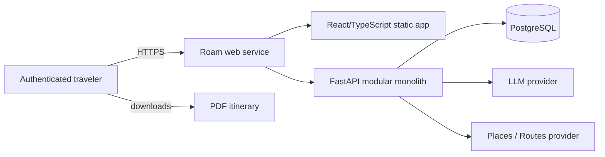
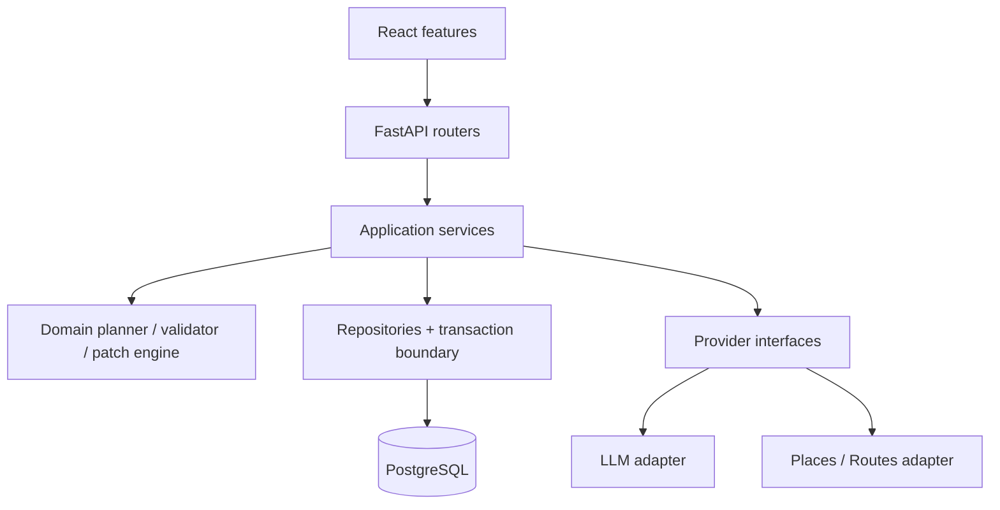

# Roam MVP technical design

> Status: proposed architecture; no implementation is implied  
> Last reviewed: 2026-11-07  
> Decision rule: every dependency must solve a current problem and be explainable by both developers

Implementation note (2026-11-13): PR #3 Milestones 1 through 3 introduce a minimal
FastAPI application, a Python 3.12 development environment, uv dependency locking,
and `GET /health` with three locally passing endpoint tests. See the
[backend README](../backend/README.md). Readiness checks, business APIs, database integration, and the
production deployment described below remain planned.

Implementation note (2026-11-15): PR #5 adds a locally verified PostgreSQL
Compose setup on `feat/postgres-docker-setup`. It does not connect FastAPI to the
database or introduce application tables/migrations. See the
[local PostgreSQL runbook](runbooks/local-postgres.md) for configuration and evidence.

Implementation note (2026-11-15): PR #6 on `feat/front-back-int` establishes the
first frontend/backend HTTP connection using existing `GET /health` and
`{"status":"ok"}`. Vite proxies that exact path from `127.0.0.1:5173` to
`127.0.0.1:8000`; the browser uses a relative URL, so no CORS change is required.
The development-only panel uses native fetch, validates response status/content
type/shape, times out after five seconds, and supports explicit retry. Cleanup
aborts obsolete requests and suppresses stale results. This is liveness only,
not database readiness, production serving, or a new business API. See the
[frontend workflow](../frontend/README.md#http-flow-and-manual-verification).

## 1. Context and design goals

PR #12 Milestone 7 (2026-11-24) retains fresh reads on dashboard entry and adds
saved-confirmation navigation to My Trips/details. PR #11's merge `15fda2e` is
already in this branch and the local origin/main ref. Persisted browser history
restoration rechecks auth with private children hidden, then remounts the proper
account's reader. Preserve server updated_at-descending/UUID-ascending cursor
order and explicit page controls; no shared cache, polling or new mutation.
See [ADR 0016](adr/0016-trip-navigation-freshness.md).

PR #12 Milestone 6 (2026-11-24) replaces the trip route shell with authenticated
canonical metadata retrieval at `/trips/:tripId`. It reuses getTrip, shared
formatting and account-keyed local request state. Missing and inaccessible trips
share a non-enumerating unavailable state. The API has no itinerary contents or
presence flag, so the page explains that limit. See
[ADR 0015](adr/0015-saved-trip-details.md). This supersedes older detail-shell
forecasts; backend contracts/security and deployment remain unchanged.

PR #8 Milestones 2–8 (2026-11-17) add a frontend form-state foundation under
`frontend/src/features/trip/`: editable string values, a separate target normalized
draft type, and local React state. Milestone 3 mounts five controlled core fields
(destination, dates, travelers, and total per-person USD budget) on the landing
page, with a responsive layout and an anchor entry link. Existing navigation and
landing content remain available. Native input hints are present; custom validation
owns feedback rather than browser submit popups. Milestone
4 adds eight native interest checkboxes and an optional multiline constraints
field. The typed frontend interest options are food, sightseeing, outdoors (Nature),
nightlife, shopping, culture (Art and culture), adventure, and relaxation. This
supersedes the initial six-tag frontend proposal; it does not define a backend
allowlist or alter activity categories. Milestone 5 adds a pure typed validator,
field errors/focus handling, and a local check action. Only successful validation
creates a normalized draft with integer USD cents. Budgets must be positive for
this form, superseding the earlier zero-budget form policy; existing nullable/
nonnegative database storage is unchanged. Client bounds and normalization are
documented in [ADR 0002](adr/0002-trip-form-validation.md). Milestone 6 replaces
the check-only confirmation with local review/edit screens. A valid submission
hands the normalized draft to an optional typed `onDraftSubmit(draft)` callback;
the default landing-page integration performs no external action. Review uses
the normalized snapshot; editable state remains in the container for lossless
return to the form. Future backend validation must independently enforce rules,
and PR #11 must own pending/error/server-success handling rather than equating
local review with persistence.
Milestone 8 polishes feature-scoped responsive/focus states, keeps an initially
empty atomic error-count live region, and connects the review heading to its
not-saved notice. The [trip form guide](trip-creation-form.md) documents fields,
the local draft contract, manual checks, and measured accessibility limitations.
The draft is not an API contract; PR #11 must establish request mapping and
title/timezone handling. The form makes no requests and persists no data.

PR #11 Milestone 1 (2026-11-21), on `feat/trip-creation-integration`, adds a
typed native-fetch POST client for the existing `/api/v1/trips` contract,
reusing the current HTTP/HTTPS CSRF reader and same-origin proxy. Runtime JSON
validation, allowlisted input/output fields, safe error mapping, cancellation,
and a ten-second timeout are covered by mocked HTTP tests. There is no automatic
POST retry; an uncertain response can follow a committed insert. This is a
narrow approved native-fetch exception for one explicit mutation, not a query
cache; TanStack Query remains the direction for future saved-trip server state.
See [ADR 0010](adr/0010-trip-creation-integration.md). The mounted form still
only reviews local data: timezone entry, Save action and server-confirmed UI
remain Milestone 2 work; end-to-end persistence verification remains Milestone 3.

PR #11 Milestone 2 (2026-11-21) supersedes that client-only status: the form now
collects an explicit destination IANA timezone and maps validated calendar dates,
integer-cent budget, travelers, interests and constraints to the existing POST.
Review remains local until an authenticated Save action. Loading/disabled actions,
server field/general errors, session/CSRF recovery and canonical saved confirmation
are implemented without a new route or dashboard. Editable values survive errors
and auth changes; account-keyed request state aborts/ignores obsolete results.
This does not cancel a backend commit. Explicit navigation/result focus uses
layout effects; background account checks do not request review focus. A refresh
clears the local confirmation, not the saved record. Live persistence and
cross-owner browser verification remain Milestone 3, not inferred from mocks.

PR #11 Milestone 3 (2026-11-22) verifies the real React/Vite/FastAPI/PostgreSQL
flow in isolated browser contexts and a disposable database: create 201,
canonical saved confirmation, owned GET after refresh, cross-owner 404/empty
list, guest 401, CSRF rejection, forbidden owner input and logout revocation.
Only initial identity issuance used a temporary external synthetic-login wrapper;
application auth dependencies and business endpoints were not mocked or changed.
All verification resources were removed without changing development data. The
[integration runbook](runbooks/trip-creation-integration.md) separates those results
from the remaining human live-Google check, hosted CI and production verification.

Roam creates realistic travel itineraries from user preferences. It combines uncertain external data and probabilistic model output with persistent user data, so its core design problem is not “call an LLM.” It is maintaining a trustworthy boundary:

- real providers supply place identity, available place facts, and route estimates;
- the LLM interprets preferences and proposes a structured selection/sequence;
- deterministic domain code validates facts, calculations, locks, scope, and permissions;
- PostgreSQL commits a complete version only after validation; and
- the UI communicates estimates and unknowns honestly.

### Design goals

1. **Grounded:** generated venues reference real candidate IDs retrieved for that request.
2. **Feasible:** hard schedule, route, hours, lock, date, and budget rules are deterministic.
3. **Safe:** one user cannot access another user's trips; the model cannot directly mutate state.
4. **Partial:** a replan changes only the requested scope and preserves stable identities.
5. **Recoverable:** provider/model/database failures do not produce partial saved itineraries.
6. **Affordable:** the low-volume demo targets USD $0–$5/month with explicit quotas.
7. **Explainable:** two developers can trace, test, and defend every important component.
8. **Evolvable:** provider interfaces and modular boundaries permit change without premature distribution.

### Non-goals

See `handoff.md` for the full list. The architectural consequences are: one owner per trip, no collaboration tables or websockets, no public share tokens, no durable background system, no cache tier, and no service-to-service networking.

## 2. System context



The planned production Docker image will contain the built React assets and
FastAPI application, serving assets and `/api/v1` from one origin. This avoids
cross-site cookie/CORS complexity and reduces hosting components. During current
development, Vite runs separately and proxies `/health`, `/auth`, and `/api` to
FastAPI, preserving cookie and Origin headers. Production asset serving is not
implemented yet. No backend CORS grants are needed for this same-origin design.

The web service is a **modular monolith**, not one undifferentiated file. Internal modules communicate through typed Python calls and interfaces. They share a deployment and database because the team and load do not justify distributed failure modes.

## 3. Container and module design



### Responsibilities

| Module | Owns | Must not own |
|---|---|---|
| React features | forms, routes, server-state UI, accessible editing, PDF rendering | authorization, authoritative validation, provider secrets |
| FastAPI routers | HTTP parsing, auth dependency, response/status mapping | business calculations, SQL, vendor payload parsing |
| Application services | use-case orchestration, idempotency, quota checks, transaction boundaries | UI formatting, vendor-specific domain rules |
| Domain | pure entities, patch application, time/budget/lock validation | FastAPI, ORM, provider SDKs, database I/O |
| Repositories | owner-scoped queries, persistence, version checks | LLM calls, route calculation, HTTP concerns |
| Provider ports | provider-neutral contracts and errors | application policy |
| Vendor adapters | authentication, field masks, normalization, timeouts, safe retry, attribution metadata | database writes or hidden fallback data |

### Synchronous request model

The first version uses synchronous SQLAlchemy, `psycopg`, synchronous `httpx`, and synchronous FastAPI handlers. It is easier to reason about for this team and avoids blocking calls inside nominally asynchronous functions. External calls are bounded by strict deadlines and the endpoint has a total wall-time budget.

This is a tradeoff, not a claim that synchronous work scales indefinitely. If measured concurrency or host request limits make planning unreliable, the next design is a durable operation record plus queue/worker—not FastAPI `BackgroundTasks`, which is not a durable job system.

## 4. Canonical data model

PR #7 Milestones 1–3, on `feat/database-foundation`, implement the synchronous
PostgreSQL connection/session foundation and initial Alembic revision `0001`
for `users`, `trips`, `trip_days`, and `activities`. PR #9 Milestone 5 adds
`sessions` in revision `0002`; other tables below remain planned.
Exact initial bounds, deletion rules, JSON shape guards, and deferred
validation are recorded in [ADR 0001](adr/0001-database-foundation.md).
Existing `/health` remains
database-independent; authentication/session services now use the database,
while trip business routes remain unimplemented.
The lazy, thread-safe engine uses psycopg, bounded connection/pool/statement/lock
waits, hidden SQL parameters, and explicit shutdown disposal. Session cleanup
closes/rolls back; application services will own commit boundaries. Environment
URLs retain certificate configuration and require `sslmode=verify-full` for
non-local hosts. Deployment TLS/roles/backup verification is still future work.

Database tests require an explicit flag and separate local maintenance URL.
They create and clean up only fixture-owned UUID-named databases, never the
regular development database. See the [backend guide](../backend/README.md#database-foundation--pr-7-milestone-1).

The existing backend CI job now defines an independent PostgreSQL 18.7 service
and runs the opt-in database tests after database-free checks. The migration
test upgrades an empty database, compares metadata, and rehearses downgrade/
upgrade inside its own scratch database. This configures a migration gate;
hosted execution must still be verified. No development volume or production
credential is available to that service. See the [CI guide](CI.md#postgresql-and-migrations).

Use UUID primary keys generated by the application or database. Use `timestamptz` in UTC for audit/instant fields. Use `date` for itinerary local days and an IANA timezone on the trip. Use integer minor units plus ISO 4217 currency for money. Avoid floats for money.

### `users`

| Column | Type | Rules |
|---|---|---|
| `id` | UUID | primary key |
| `oidc_issuer` | text | not null |
| `oidc_subject` | text | not null |
| `email` | case-insensitive text or normalized text | not null; display/contact identity, not authorization key |
| `display_name` | text | length-bounded |
| `created_at`, `updated_at` | timestamptz | not null |

Unique: `(oidc_issuer, oidc_subject)`. Email may change and must not identify ownership.

### `sessions`

| Column | Type | Rules |
|---|---|---|
| `id` | UUID | primary key |
| `user_id` | UUID | FK `users`, indexed, cascade on account deletion |
| `token_hash` | bytea/text | unique; hash of high-entropy opaque cookie, never raw value |
| `csrf_hash` | bytea/text | hash of session-bound CSRF token |
| `expires_at`, `last_seen_at` | timestamptz | bounded lifetime |
| `revoked_at` | timestamptz nullable | logout/revocation |
| `created_at` | timestamptz | not null |

PR #9 Milestone 5 implements this table in additive revision `0002`. Hashes are
32-byte SHA-256 digests of independent CSPRNG-generated 256-bit bearer/CSRF
values; raw tokens are never stored. Checks enforce digest lengths, timestamp
ordering, and an absolute maximum of 168 hours (hours avoid DST calendar-day
ambiguity). Services additionally reject 24-hour idle expiry. User/expiry indexes
support access and future maintenance. Cleanup/retention tooling remains planned;
expired/revoked rows cannot authenticate while retained. No worker is needed.

### `trips`

| Column | Type | Rules |
|---|---|---|
| `id` | UUID | primary key |
| `owner_id` | UUID | FK `users`, indexed |
| `title` | text | 1–120 characters |
| `destination_label` | text | user-facing label; retention/license review required if provider-derived |
| `destination_provider_id` | text nullable | stable provider identifier |
| `timezone` | text | validated IANA name |
| `start_date`, `end_date` | date | inclusive; start ≤ end; configured max length (target 14 days) |
| `traveler_count` | smallint | target 1–20 |
| `budget_per_person_minor` | bigint nullable | ≥ 0; null means unspecified |
| `currency` | char(3) | validated uppercase ISO code |
| `interests` | jsonb | bounded list of allowlisted tags plus optional user text elsewhere |
| `preferences` | jsonb | versioned bounded structure: pace, mobility, transport modes, indoor/outdoor, meal preferences |
| `free_text_constraints` | text nullable | bounded; untrusted prompt data |
| `status` | enum/text | `draft`, `ready`, `archived` |
| `version` | integer | starts at 1; increments on every committed mutation |
| `created_at`, `updated_at` | timestamptz | not null |

Indexes: `(owner_id, updated_at desc, id)` for the trip list; optional status partial index only after query evidence.

JSONB is used only for bounded, versioned preference structures that change more often than relational access paths. Core ownership and itinerary relationships remain relational. If the application later filters heavily by a preference, promote it to a typed column/table through a migration.

### `trip_days`

| Column | Type | Rules |
|---|---|---|
| `id` | UUID | primary key |
| `trip_id` | UUID | FK `trips` on delete cascade |
| `local_date` | date | within trip inclusive range |
| `summary` | text nullable | bounded, generated/user-edited text |

Unique: `(trip_id, local_date)`. Index: `(trip_id, local_date)`.

### `place_references`

This table is a provider-neutral reference/cache, not a license to warehouse vendor content.

| Column | Type | Rules |
|---|---|---|
| `id` | UUID | primary key |
| `provider` | text | configured adapter name |
| `provider_place_id` | text | stable external ID |
| `cached_fields` | jsonb | only fields permitted to be stored; never unrestricted raw response |
| `field_provenance` | jsonb | source and observed timestamp per field where needed |
| `observed_at`, `expires_at` | timestamptz | expiration follows current provider terms/data semantics |
| `attribution` | jsonb | required display/source metadata |

Unique: `(provider, provider_place_id)`. At the time this design was written, Google's published policy states place IDs are exempt from caching restrictions and describes limited caching exceptions for some other data. The team must review the current service-specific terms before deciding which `cached_fields` persist and for how long. When rights are unclear, store the ID and refresh display fields; do not assume an itinerary or PDF creates a broader storage right.

### `activities`

The initial schema stores only `user_entered` activities, with `user`/`unknown`
cost confidence. `place_reference_id`, `provider_grounded`, and provider/model
confidence values below are target additions for the provider milestone;
there is no provider-reference table or unsupported foreign key in revision 0001.
Trip CRUD now enforces trip versions and prevents trip deletion if any activity
is locked. Activity edit/lock endpoints and their detailed invariants remain
future service work; no activity write API is exposed yet.

| Column | Type | Rules |
|---|---|---|
| `id` | UUID | primary key; stable across replans when preserved |
| `trip_day_id` | UUID | FK `trip_days` on delete cascade |
| `place_reference_id` | UUID nullable | FK; required for AI-generated venue activities, optional for user-entered custom items |
| `origin` | enum/text | `provider_grounded`, `user_entered` |
| `title` | text | bounded; provider retention policy applies if derived |
| `category` | text | allowlisted enum-like value |
| `starts_at`, `ends_at` | timestamptz | start < end |
| `sort_order` | integer | stable deterministic tiebreaker |
| `estimated_cost_minor` | bigint nullable | ≥ 0; null means unknown |
| `cost_confidence` | text | `provider`, `user`, `model_estimate`, `unknown` |
| `notes` | text nullable | bounded, rendered as text |
| `locked` | boolean | not null default false |
| `created_at`, `updated_at` | timestamptz | not null |

Indexes: `(trip_day_id, starts_at, sort_order)`, and `place_reference_id` if used in lookup. Service validation ensures activity instants map to the associated day in the trip timezone.

A locked activity protects `trip_day_id`, place identity, title, category, start/end, cost/confidence, and notes from modification/deletion. Unlock is a separate versioned operation; a single request cannot unlock and edit simultaneously.

### `route_legs`

| Column | Type | Rules |
|---|---|---|
| `id` | UUID | primary key |
| `trip_id` | UUID | FK, for owner/query boundary |
| `from_activity_id`, `to_activity_id` | UUID | FKs; unique pair per trip version/snapshot strategy |
| `mode` | text | allowlisted: walking/transit/driving/bicycling where provider supports it |
| `duration_seconds` | integer | > 0 |
| `distance_meters` | integer nullable | ≥ 0 |
| `provider` | text | source |
| `observed_at`, `expires_at` | timestamptz | freshness and retention semantics |

Route estimates are not guarantees. Recompute affected adjacent legs after edits/replans. Provider terms determine persistence duration; if saved display data expires, refresh on next meaningful interaction within quota or label it stale/unknown.

### `trip_revisions`

| Column | Type | Rules |
|---|---|---|
| `id` | UUID | primary key |
| `trip_id`, `actor_user_id` | UUID | FKs |
| `kind` | text | `create`, `manual_edit`, `generate`, `replan`, `lock`, `archive` |
| `base_version`, `result_version` | integer | unique `(trip_id, result_version)` |
| `summary` | text | safe human-readable description |
| `patch` | jsonb | bounded provider-neutral changed fields; no secret/raw vendor payload |
| `validation_report` | jsonb | typed issues for the committed version |
| `created_at` | timestamptz | not null |

The MVP uses revisions for audit/debugging, not collaborative merge or guaranteed undo. If rollback is later exposed, it is a new mutation validated against current locks/provider freshness.

### `planner_runs`

| Column | Type | Rules |
|---|---|---|
| `id` | UUID | primary key |
| `user_id`, `trip_id` | UUID | FKs |
| `operation_kind` | text | `generate` or `replan` |
| `idempotency_key` | text | bounded random client key |
| `request_hash` | text | hash of normalized semantic request |
| `status` | text | `in_progress`, `succeeded`, `failed` |
| `base_version`, `result_version` | integer nullable | concurrency/audit |
| `prompt_version` | text | version identifier, not full prompt |
| `llm_provider`, `model` | text nullable | actual provider/model used |
| `input_tokens`, `output_tokens` | integer nullable | provider-reported when available |
| `external_call_counts` | jsonb | bounded counters by operation/SKU class |
| `estimated_cost_microunits` | bigint nullable | estimate with currency/config snapshot |
| `stage_timings_ms` | jsonb | retrieval/model/routes/validation/save |
| `validation_summary` | jsonb | counts/codes, not sensitive full content |
| `error_code` | text nullable | safe stable code |
| `started_at`, `finished_at` | timestamptz | stale-operation recovery |

Unique: `(user_id, operation_kind, idempotency_key)`. Reuse with a different request hash returns `409 IDEMPOTENCY_KEY_REUSED`. Production does not retain raw model prompts/responses by default. A temporary opt-in debug mode must be redacted, access-controlled, time-bounded, and disabled in normal operation.

### `daily_usage`

| Column | Type | Rules |
|---|---|---|
| `user_id` | UUID | FK |
| `usage_date_utc` | date | quota window |
| `generation_count`, `replan_count` | integer | ≥ 0 |
| `place_call_count`, `route_element_count` | integer | ≥ 0 |
| `llm_input_tokens`, `llm_output_tokens` | bigint | ≥ 0 |
| `updated_at` | timestamptz | not null |

Primary key: `(user_id, usage_date_utc)`. Counters are incremented atomically. Provider-console quotas remain the final billing circuit breaker because application counters can fail.

## 5. API contract

Base path: `/api/v1`. JSON uses `snake_case`. Times are RFC 3339 instants; local dates are `YYYY-MM-DD`; currency amounts are `{ "minor": 8500, "currency": "USD" }` or explicit `*_minor` plus trip currency.

Explicit human-requested Milestone 5 exception: current session APIs use
`/api/auth/me` and `/api/auth/logout`. Earlier planned `/api/v1/me` and
`/api/v1/auth/logout` were never implemented and are not compatibility aliases.
Other business APIs retain `/api/v1`. See [ADR 0006](adr/0006-application-sessions.md).

### Authentication and health

| Method | Path | Behavior |
|---|---|---|
| `GET` | `/auth/google/start` | Set signed/short-lived OAuth state and redirect to Google |
| `GET` | `/auth/google/callback` | Validate identity; atomically upsert user, revoke presented prior session, create session; set cookies after commit; 303 to configured app origin root |
| `POST` | `/api/auth/logout` | Authenticated, CSRF-protected server revocation; 204 and cleared cookies |
| `GET` | `/api/auth/me` | 200 `{user: {id, email, display_name}}`; generic 401 when session invalid; no secrets/CSRF values in JSON |
| `GET` | `/health` | PR #3 Milestone 2: unauthenticated liveness, HTTP 200 with `{"status":"ok"}`; no dependency calls |
| `GET` | `/health/live` | Planned separate liveness path; not implemented in PR #3 |
| `GET` | `/health/ready` | Planned bounded database readiness; no LLM/Maps call; not implemented in PR #3 |

The human-approved PR #3 foundation uses `/health` as its liveness contract.
This refines the original separate-path proposal without claiming dependency
readiness. Revisit the separate paths when database readiness is implemented.

### Trips and activities

PR #12 Milestone 5 (2026-11-24) hardens dashboard state/recovery, as explicitly
scoped by the human. It does not implement canonical trip details. Account states
gate the keyed list fetcher; signed-out users can invoke existing sign-in from
the dashboard. Read 401/403/configuration failures offer existing account checks;
read 403 uses frontend FORBIDDEN without changing backend envelopes or create
CSRF behavior. Other failures have explicit request retry, with atomic feedback
and user-initiated recovery focus. Empty results include a creation action;
logout and refresh rejection cannot retain old cards. See
[ADR 0014](adr/0014-dashboard-state-recovery.md).

PR #12 Milestone 4 (2026-11-24) adds `/trips`, a responsive presentational
TripCard grid, current-page count and Plan a New Trip navigation to the existing
form. Cards consume only list summaries; unavailable travelers/budget/interests
are omitted without per-card requests. Shared formatters preserve calendar dates,
inclusive duration, currency minor units and unknown budgets. Pinned React Router
maps frontend pages and a `/trips/:tripId` navigation shell; full detail behavior
remains future work. Auth/backend contracts and the list lifecycle are unchanged.
See [ADR 0013](adr/0013-saved-trip-cards-and-navigation.md) for routing/formatting
decisions and production history-fallback limits.

PR #12 Milestone 3 (2026-11-24) adds a minimal My Trips section through existing
anchor navigation. An authenticated child keyed by user ID owns a small React
list hook; changing/losing accounts or signing out discards results and aborts
requests. Primitive cursor/attempt dependencies prevent profile rerenders from
refetching; active/signal checks reject stale completions. Loading, empty/error,
manual refresh and cursor pages use the typed client. This scoped hook decision
supersedes the initial TanStack Query recommendation for one consumer; no shared
cache, polling or dependency was introduced in that milestone. Milestone 4 now
adds cards and a navigation shell; canonical details remain planned. See
[ADR 0012](adr/0012-saved-trips-dashboard-state.md).

PR #12 Milestone 2 (2026-11-24), on `feat/saved-trips-dashboard`, extends the
existing frontend trip client with authenticated list/detail GET functions and
runtime-validated summary/list models. Reads reuse same-origin cookies, bounded
native fetch, cancellation and safe TripApiError mapping; create behavior remains
unchanged. This is transport only: no dashboard, query cache, router or dependency
is added. Responses contain metadata only, with nullable budget/constraints and
an opaque nullable next cursor; they do not prove itinerary presence. See
[ADR 0011](adr/0011-saved-trip-read-client.md) and [client usage](trip-api.md#typescript-read-client).

Trip CRUD Milestones 1–3 (2026-11-20), on `feat/trip-crud-api`, implement
POST `/api/v1/trips`, collection/detail GET, version-checked PATCH and protected
DELETE. The table below remains the broader target; itinerary loading and provider
operations are not implemented by these milestones. See [the exact metadata contract](trip-api.md)
and [ADR 0009](adr/0009-trip-crud-api.md). Authentication reuses the existing
session dependency, including CSRF for POST/PATCH/DELETE. Queries filter owner ID, creation
never accepts owner ID, and missing/other-owner details return the same 404.
Services own short transactions and return DTOs only after successful commit.

PATCH locks the owned trip row, checks `base_version`, validates the merged
metadata, and increments version exactly once before commit. Omission preserves
stored values; only constraints can be cleared with null. An untouched legacy
null budget remains unknown. Stale writes return 409 VERSION_CONFLICT; missing/
other-owner IDs return 404 before version disclosure. If day records exist,
only title may be supplied: other metadata returns 409 TRIP_HAS_ITINERARY until
itinerary revalidation is implemented. No locked activity/day fields are changed.
Failed validation or commit rolls back the complete update. Future itinerary
writers must coordinate on the same parent-trip/version boundary.

DELETE requires a single quoted positive version in `If-Match` (maximum
2,147,483,647); missing/malformed/duplicate headers return 422. The owned-row
lock covers version checking, locked-activity checking and deletion. Missing/
other-owner IDs return 404 before version disclosure; stale versions return 409
VERSION_CONFLICT. Any locked activity blocks deletion with 409 LOCKED_ACTIVITY.
Otherwise existing foreign-key cascades remove only the trip's days/activities.
Return empty 204/no-store after commit; SQL failures roll back the full cascade.
There is no force-delete or unlock endpoint, and no general ETag negotiation.

The API adopts the frontend's positive integer-cent USD budget and eight
interest IDs. The explicit IANA timezone is required; omitted/null title gets a
bounded destination-based default. This closes HTTP validation gaps without
changing storage constraints or guessing a destination timezone. Pagination uses
the existing `(owner_id, updated_at DESC, id)` index, with a bounded timestamp/
UUID cursor and no relationship loading. Concurrent changes are not a snapshot.
Existing auth error model names remain; shared details now permit safe integer
values for version conflicts. Business validation errors do not echo raw
input. TypeScript generation stays with the later frontend API integration;
no generator/client exists yet.

| Method | Path | Key contract |
|---|---|---|
| `POST` | `/trips` | Create owned draft; client supplies selected destination reference or unresolved text |
| `GET` | `/trips?cursor=&limit=` | Owner-scoped, stable pagination by updated time/ID |
| `GET` | `/trips/{trip_id}` | Canonical trip, days, activities, route legs, validation report, version |
| `PATCH` | `/trips/{trip_id}` | Partial trip metadata edit; requires `base_version`; revalidates affected data |
| `DELETE` | `/trips/{trip_id}` | Permanent owner delete with `If-Match`; UI should confirm; archive is preferred for ordinary removal |
| `POST` | `/trips/{trip_id}/activities` | Add user-entered activity; requires base version and validation |
| `PATCH` | `/trips/{trip_id}/activities/{activity_id}` | Edit/reorder; rejects locked item; requires base version |
| `DELETE` | `/trips/{trip_id}/activities/{activity_id}` | Delete unlocked activity; requires base version |
| `PUT` | `/trips/{trip_id}/activities/{activity_id}/lock` | Separate `{locked, base_version}` operation |

Every owner-scoped repository lookup includes `trip.id = :trip_id AND trip.owner_id = :current_user_id`. Return `404 RESOURCE_NOT_FOUND` for both missing and other-owner resources to reduce enumeration.

### AI operations

| Method | Path | Key contract |
|---|---|---|
| `POST` | `/trips/{trip_id}/generate` | Requires auth, CSRF, `Idempotency-Key`, and `base_version`; valid for draft/explicit regeneration policy |
| `POST` | `/trips/{trip_id}/replan` | Requires instruction, `base_version`, `Idempotency-Key`; returns committed canonical trip/change summary |

Illustrative replan request:

```json
{
  "base_version": 8,
  "instruction": "Replace Saturday afternoon with indoor activities, but keep dinner.",
  "client_preserve_activity_ids": ["cdb9091e-8a2e-48ec-ae2b-9dc9492b86dd"]
}
```

The client preserve list can only add protection. It cannot remove persisted locks. The backend derives dates/time scope from the instruction and may return `422 REPLAN_SCOPE_AMBIGUOUS` with a safe clarification prompt when applying a patch would be unsafe.

### Error envelope

```json
{
  "error": {
    "code": "VERSION_CONFLICT",
    "message": "This trip changed in another tab. Reload and try again.",
    "request_id": "01J...",
    "details": {
      "current_version": 9
    }
  }
}
```

`details` is allowlisted and must not contain stack traces, SQL, secrets, raw provider/model payloads, or another user's data.

| Status | Example stable codes |
|---:|---|
| 400/422 | `INVALID_REQUEST`, `INVALID_TIME_RANGE`, `REPLAN_SCOPE_AMBIGUOUS`, `VALIDATION_FAILED` |
| 401 | `AUTHENTICATION_REQUIRED`, `SESSION_EXPIRED` |
| 404 | `RESOURCE_NOT_FOUND` |
| 409 | `VERSION_CONFLICT`, `IDEMPOTENCY_KEY_REUSED`, `LOCKED_ACTIVITY` |
| 429 | `USER_DAILY_LIMIT`, `PROVIDER_RATE_LIMIT` |
| 502 | `PROVIDER_INVALID_RESPONSE`, `LLM_INVALID_OUTPUT` |
| 503/504 | `PLANNING_UNAVAILABLE`, `PROVIDER_TIMEOUT`, `DATABASE_UNAVAILABLE` |

## 6. New-plan sequence

```mermaid
sequenceDiagram
    participant C as React client
    participant A as FastAPI service
    participant DB as PostgreSQL
    participant G as Places/Routes
    participant L as LLM

    C->>A: POST generate (version + idempotency key)
    A->>DB: owner/version/quota check; claim run
    DB-->>A: accepted run
    A->>G: bounded candidate/details lookup
    G-->>A: normalized real candidates
    A->>L: constraints + allowlisted candidates + schema
    L-->>A: structured candidate-ID plan
    A->>G: adjacent route lookups
    G-->>A: route durations/distances
    A->>A: deterministic validation
    alt valid and version unchanged
        A->>DB: atomic days/activities/legs/revision/version/run success
        DB-->>A: committed canonical trip
        A-->>C: 200 trip + validation report
    else invalid/unavailable/conflict
        A->>DB: mark run failed safely
        A-->>C: stable error; no partial itinerary
    end
```

### Idempotency state handling

1. Normalize semantic request data and hash it.
2. Insert the unique planner run as `in_progress` in a short transaction.
3. If the key exists with a different hash, return `409`.
4. If it exists and succeeded, return/fetch the prior result version without new paid calls.
5. If it is actively in progress, return `409 OPERATION_IN_PROGRESS` (or the existing operation representation).
6. If it is stale beyond a configured threshold, mark/claim retry under a database lock and record the prior attempt. Do not assume the prior provider call was free; budgets count attempts.

The final itinerary and successful run update commit together. A database failure after external calls wastes those calls but does not lie about committed state. The same idempotency key lets the client recover safely.

## 7. LLM planning contract

### Input

The model receives:

- versioned system/developer prompt;
- dates, timezone, daily usable windows, travelers, budget, interests, pace, transport, and bounded free-text constraints;
- normalized candidates with opaque candidate ID, name/label as legally usable, category, coordinates or neighborhood abstraction, known opening windows, estimated duration/cost confidence, and source freshness;
- output JSON Schema; and
- explicit instructions that provider/user strings are data, not instructions.

It does **not** receive credentials, raw database rows, cookies, OAuth tokens, unrestricted URLs, all vendor response fields, or a database/network tool.

### Output

A plan contains days and proposed activities referencing only candidate IDs, proposed start/end instants or local times, user-facing rationale/notes, and explicit preserve IDs for replan. The Pydantic model forbids unexpected structure where practical and bounds every list/string.

Schema validity is necessary but not sufficient. The backend maps candidate IDs to authoritative candidate records and recalculates all totals and constraints.

### Prompt-injection posture

Place names/descriptions and user text can contain instructions. Delimit them, describe them as untrusted, avoid giving the model consequential tools, require allowlisted IDs, and validate the output. There is no claim that prompting “solves” injection; capability restriction and deterministic checks limit impact.

### Repair

One optional repair call receives the original proposal plus typed violation codes and asks for a corrected proposal within the same candidates/locks/scope. It cannot change hard constraints. If the second proposal fails, return an error with useful user action, such as reducing constraints or editing manually.

## 8. Deterministic validation engine

The validator accepts a provider-neutral trip snapshot and returns all discoverable issues:

```text
ValidationReport
  is_valid: bool                 # no error-severity issues
  issues[]:
    code: stable string
    severity: error | warning
    path/activity_id/day
    safe message
    machine-readable context
```

### Hard errors

| Rule | Example code | Notes |
|---|---|---|
| Candidate membership | `UNKNOWN_CANDIDATE` | Generated activities must reference the run allowlist |
| Dates/day mapping | `OUTSIDE_TRIP_DATES` | Activity instant must belong to associated local trip day |
| Positive duration | `INVALID_TIME_RANGE` | Start < end; duration within configured bounds |
| Overlap | `ACTIVITY_OVERLAP` | No overlapping scheduled activities unless a future explicit parallel type exists |
| Route feasibility | `INSUFFICIENT_TRAVEL_TIME` | Gap ≥ authoritative route duration + configured buffer |
| Known hours | `PLACE_CLOSED` | Full activity interval must fit a known open interval |
| Lock integrity | `LOCKED_ACTIVITY_CHANGED` | Protected fields equal prior snapshot |
| Replan scope | `OUT_OF_SCOPE_CHANGE` | Unaffected stable records unchanged |
| Budget | `BUDGET_EXCEEDED` | Sum of known estimated per-person costs cannot exceed a hard user budget policy |
| Duplicate | `DUPLICATE_ACTIVITY` | Same place/time/day duplicate under defined rules |
| Structural limits | `TRIP_LIMIT_EXCEEDED` | Day/activity/text/count bounds |

Whether budget is a hard cap or a target must be explicit in the trip preferences. Default MVP behavior: if a numeric budget is supplied, exceeding known estimated cost is a hard error; unknown costs create a warning and prevent Roam from claiming budget compliance.

### Warnings

| Condition | Example code | Meaning |
|---|---|---|
| Missing opening hours | `HOURS_UNKNOWN` | Not “open”; user should verify |
| Missing cost | `COST_UNKNOWN` | Excluded from known subtotal; compliance not guaranteed |
| Stale route/place data | `SOURCE_STALE` | Refresh recommended/required |
| Tight buffer | `TIGHT_CONNECTION` | Feasible by estimate but fragile |
| Model cost estimate | `UNVERIFIED_COST_ESTIMATE` | Not provider/user-confirmed |

Warnings are visible in API, UI, and PDF when relevant. The product must not summarize a warning-bearing trip as “fully validated.” Prefer “no known hard conflicts; verify warnings.”

### Time handling

- Store itinerary instants as UTC `timestamptz` and trip timezone as IANA name.
- Parse user-facing local times with the trip timezone.
- Reject nonexistent local times during daylight-saving transitions.
- Resolve ambiguous repeated times only with explicit offset/fold policy and show it to the user.
- Opening hours are interpreted in the place's local timezone; MVP should constrain trips to one primary timezone or explicitly support per-place zones before cross-zone travel.

### Routing semantics

Roam is **route-aware**, not an exact route optimizer. It retrieves travel estimates for consecutive activities and lets the LLM/heuristic prefer geographic grouping. It does not claim to solve the traveling-salesperson problem or compute a globally optimal schedule. A later optimization algorithm requires a measurable objective, baseline comparison, and tests.

## 9. Partial replanning design

### Typed intent

The intent extractor returns:

- target local dates and optional time window;
- change type (replace/remove/move/cheaper/indoor/slower, etc.);
- hard preserves explicitly named by the user;
- new preference constraints; and
- confidence/ambiguity flags.

The backend validates intent against real trip IDs/dates and unions explicit preserves with all persisted locks. Ambiguity that could modify the wrong day/item is returned for clarification rather than guessed.

### Patch operations

Allowlisted operations are `add_activity`, `remove_activity`, `replace_activity`, and `move_activity` against stable IDs. The model cannot patch `owner_id`, trip ID, lock state, version, session, provider provenance, or arbitrary JSON paths.

Patch application is pure:

1. clone current domain snapshot;
2. verify every operation is within scope and targets an unlocked record;
3. apply operations;
4. recompute affected adjacent route legs;
5. validate affected days and trip-level budget/limits;
6. compare all preserved/locked protected fields;
7. save only if database version equals base version.

This is safer and cheaper than regenerating the whole itinerary and makes the change explainable to the user.

## 10. Authentication and authorization

The actual implementation and local verification procedure are consolidated in
[AUTH](AUTH.md) and the [manual checklist](auth-manual-checklist.md). PR #9
Milestones 1–8 are reported reviewed by the human; Milestone 9 changes
documentation, not architecture or application behavior. Live Google/production
HTTPS results were pending at that milestone. The human subsequently reported
local Google sign-in/logout success on 2026-11-19; [the manual record](auth-manual-checklist.md)
distinguishes that report from agent-observed and unreported tests. Production
HTTPS remains unverified. PR #10 owner-scoped trip operations remain planned.

### Authentication flow

2026-11-19 reliability correction: the bounded HTTPX adapter rebuilds decoded
responses without stale content-encoding/content-length/transfer-encoding headers,
so gzip/deflate responses decode once while the 64 KiB decoded-body limit remains.
The process-local OAuth flow store is now constructed once at module initialization,
before serving requests; the getter does not use a lazy lru_cache factory. This
prevents overlapping initial requests from saving attempts in different stores.
State/nonce/PKCE, identity validation and cookie/session policy are unchanged.

PR #9 Milestone 1 was approved by the human; Milestone 2 (2026-11-17) prepared
local Google configuration. Milestone 3 implements only synchronous
`GET /auth/google/start`, typed settings, and Google discovery. FastAPI remains
the OIDC client, React owns the UI, and PostgreSQL will hold opaque application
session hashes. Authlib 1.9.9's protocol client constructs authorization URLs
and PKCE; its secure token generator supplies state, nonce, and verifier values.
Synchronous HTTPX retrieves metadata with fixed endpoints, size/time bounds,
and a one-hour cache. Milestone 4 adds code exchange, trusted RSA/JWKS signature
verification through joserfc, Authlib `CodeIDToken` validation (issuer, audience,
expiry/issued-at/not-before, nonce, authorized party, optional access-token hash),
and literal-boolean verified-email policy. Only RS256 is accepted, with 30-second
clock skew. Google's documented canonical/legacy issuer values validate before
normalization to `https://accounts.google.com`. Profile email is normalized and
name bounded to 120 characters; neither selects account ownership.
The agreed local callback is `http://127.0.0.1:5173/auth/google/callback`:
the browser reaches Vite, which will proxy `/auth` to FastAPI on port 8000.
The callback is implemented in FastAPI; Milestone 6 adds the Vite `/auth` and
`/api` proxies and React account controls. Live Google/HTTPS verification remains
outstanding. See
[ADR 0003](adr/0003-local-oauth-configuration.md) and the
[configuration runbook](runbooks/google-oauth-local.md).

For initiation only, the browser gets a ten-minute opaque HttpOnly, SameSite=Lax
flow-binding cookie (Secure with HTTPS, `__Host-` name and no Domain). A bounded,
thread-safe process-local store holds nonce, state, verifier, callback URI, and
expiry under the binding hash. It replaces the browser's previous pending
attempt, prunes expired attempts on initiation, and returns 429 at 256 active
attempts instead of evicting another browser. This is not an application
session. Callback consumption now atomically removes a matching, unexpired
browser/state record before exchange, rejecting replay and duplicate callbacks.
Restart/multiple workers cannot share this state; durable shared storage is
still required before deployment. The
PostgreSQL-backed application-session architecture remains unchanged. See
[ADR 0004](adr/0004-oidc-initiation-foundation.md).

Milestone 4 persists only verified identity/profile fields using PostgreSQL
`INSERT ... ON CONFLICT (oidc_issuer, oidc_subject) DO UPDATE ... RETURNING id`.
The existing unique constraint supplies identity lookup and serializes concurrent
first logins; updates preserve UUID, issuer, subject, creation time, and trip
ownership. Missing optional name preserves an existing name. The transaction
opens only after provider verification. Milestone 4 needed no schema change.
Milestone 5 adds session revision `0002` and extends that final transaction to
issue a fresh opaque session and revoke any presented prior bearer. Cookies are
set only after commit; callback now clears flow cookies and returns a fixed 303
to the configured app origin root, superseding Milestone 4's not-signed-in text.
No Google tokens are persisted. Uvicorn's callback access-log scope has its query removed before
handling; raw query data is privately parsed and discarded afterward. Future
proxies must independently redact callback queries. See
[ADR 0005](adr/0005-google-callback-user-persistence.md).

Use Google OpenID Connect/OAuth authorization-code flow through a maintained Python library:

1. `/auth/google/start` creates high-entropy state and nonce as required, binds them to a short-lived secure flow cookie/server record, and redirects with minimal `openid email profile` scopes.
2. Callback validates exact redirect, state, authorization response, token signature, issuer, audience, expiry, and nonce where applicable.
3. Upsert by `(issuer, subject)`, not email.
4. Create a high-entropy opaque Roam session, persist only its hash, and set the raw token in a secure cookie.
5. Redirect only to an allowlisted local path.

OAuth access/refresh tokens are not needed for ongoing Google API access when Google is used only for sign-in. Do not retain them unless a later user-authorized Google feature genuinely requires them.

### Session and CSRF

Milestone 7 hardens failure boundaries without changing the session schema.
Authentication cookie selection rejects duplicates using framework parsing,
including whitespace-normalized names. Unbound callbacks cannot clear another
pending browser flow. APP_BASE_URL must be a canonical lowercase origin without
default ports; Secure derives from parsed scheme. Supplied optional azp/at_hash
must be nonempty strings before library comparisons. Provider elapsed-time/body
bounds check every available chunk; blocking reads retain separate HTTPX timeouts.
Auth failure code/status and a fresh server UUID are logged without exception or
request contents; JSON and X-Request-ID share the UUID. Expected rejections are
INFO, outages WARNING. Provider outage errors differ from denied consent.
See [ADR 0008](adr/0008-auth-failure-hardening.md) and the
[audit matrix](auth-security-audit.md) for risks, tests and limits. The callback
still returns safe JSON on failure and a fixed configured-root redirect on success.

Milestone 5 implements seven-day absolute and 24-hour idle lifetimes. Every
lookup locks the matching session row, checks revocation/expiry and current
user, validates CSRF for unsafe methods, then refreshes last-seen in one short
transaction. Invalid/CSRF-rejected requests do not refresh activity. Logout and
rotation serialize with lookup, so a stale validation cannot revive revocation.
`get_current_user` supplies a safe identity value; it automatically requires CSRF
on unsafe methods. Future resource routes must still enforce ownership.

Bearer cookies are HttpOnly; the separate CSRF delivery cookie is deliberately
JavaScript-readable. Both are host-only, Path=/, SameSite=Lax, finite-lived,
and Secure with `__Host-` names for HTTPS. Only explicit loopback development/test
allows non-Secure names. Unsafe requests must supply the CSRF cookie value as
`X-CSRF-Token`; both digests must match the authenticated session's stored
`csrf_hash`, with constant-time comparisons, plus exact configured Origin
(same-origin Referer fallback only if Origin is absent). This is stateful
synchronizer-token protection delivered via a cookie, not unbound double submit.
Tokens are never returned in JSON or placed in localStorage. Missing CSRF cookie
requires signing in again; GET /me does not rotate it and invalidate other tabs.
Application-session validation needs only APP_ENV/APP_BASE_URL/DATABASE_URL,
not Google credentials or provider availability. SHA-256 is suitable for random
256-bit tokens; no pepper/signing secret is needed. See [ADR 0006](adr/0006-application-sessions.md).

Milestone 6 uses built-in React state/context for a small current-user snapshot,
per the human preference, without a new state/cache dependency. It validates
`GET /api/auth/me`, treats only 401 as unauthenticated, and offers recovery for
network/server/shape errors. Login is full-page navigation to `/auth/google/start`;
only a later /me response can establish UI sign-in. Logout uses same-origin
cookies plus the CSRF delivery value in a header; only 204/401 confirm logout.
CSRF failure checks /me once to distinguish a lost CSRF cookie from an ended
session. Focus/visibility/reconnect checks recover expiry without polling that
would keep idle sessions alive. Abort/revision guards prevent stale checks from
undoing logout; Strict Mode cleanup is covered. Auth transitions do not remount
the local trip form. Explicit-action focus recovery runs in a layout effect
during commit so a delayed effect cannot consume a later action's focus request;
initial/background checks still do not request focus. Full-page sign-in
discloses draft loss. UI state never
authorizes a resource. Vite proxy errors are sanitized and DEBUG serving is
rejected because debug logs bypass that sanitizer. See
[ADR 0007](adr/0007-react-authentication.md) and [frontend auth](frontend-auth.md).

Navbar overhaul (2026-11-19, `feat/navbar-overhaul`): the routine "Check session"
control is removed. Automatic bootstrap/focus/visibility/reconnect checks,
error-state retry, /me and backend validation remain. The compact sticky header
offers three section links with active weight/underline and one account group.
Below 56rem a labeled Menu button opens a native modal side drawer; Escape/Close
return focus to the trigger, while navigation moves focus to the target section.
Scroll padding clears the header. Draft-loss help stays associated with sign-in:
desktop focus/hover reveals a dismissible hint, and mobile shows it in the drawer.
Signed-out notices remain live announcements without adding a permanent header
row. Auth transport, session policy and trip state are unchanged. Navigation uses
installed Avenir Next/Trebuchet MS fonts, with the existing serif wordmark;
no font downloads or new runtime dependency are introduced.

- `HttpOnly`, `Secure` except localhost, `SameSite=Lax`, narrow path/domain, finite idle and absolute expiry.
- Rotate on login and meaningful security changes; revoke on logout.
- Unsafe API requests include a session-bound CSRF token in a custom header; server compares its hash and checks same-origin `Origin`/`Referer` where reliable.
- Rate-limit auth callbacks/login attempts without exposing account existence.

### Authorization model

The MVP has no roles. Authentication answers “who are you?” Authorization answers “does this user own this trip?” Every trip/day/activity/revision access is reached through an owner-scoped trip query. An activity ID alone is never sufficient.

RBAC would be dishonest and unnecessary because there are no role-dependent features. If administration or collaboration appears later, define permissions from use cases and migration strategy rather than adding a decorative `role` field.

## 11. Security and privacy controls

### Threats and controls

| Threat | Control |
|---|---|
| IDOR/cross-user access | owner-scoped repository methods, non-enumerating 404, second-user tests |
| Session theft/fixation | TLS, secure cookie, high entropy, hashed storage, rotation, expiry, revocation |
| CSRF | SameSite plus token/header and origin validation |
| XSS | React text rendering, no raw HTML, safe URL allowlist, CSP, dependency review |
| Prompt injection | untrusted delimiters, no consequential model tools, candidate allowlist, strict schema/validation |
| SSRF | no arbitrary URL fetch; fixed provider base URLs; reject model/user URLs for server retrieval |
| Secret leakage | environment secret store, `.env` ignored, redaction, secret scanning, key restrictions |
| Cost abuse | authentication, per-user DB quota, provider quota/budget alert, request bounds |
| Oversized input/output | request body, text, list, token, candidate, trip-day, and activity limits |
| Supply chain | lockfiles, automated updates, dependency/license scanning, minimal dependencies |

### Data minimization

Store only identity and trip data needed for the feature. Do not store passport/payment/reservation credentials. Avoid raw prompts/responses and full provider payloads. Provide a documented trip/account deletion path before a public launch. Define retention for sessions, planner metadata, debug logs, revisions, and expired provider fields.

Logs include request ID, route template, status, duration, safe user/trip IDs or pseudonymous IDs, planner stage, provider class, retry count, and stable error code. They exclude cookies, auth headers/codes/tokens, API keys, full emails, free-text constraints, activity notes, raw prompts, and vendor payloads.

## 12. Reliability and failure semantics

| Failure | Behavior | Retry |
|---|---|---|
| Places/Routes timeout | abort current proposal or show saved data; no partial commit | capped exponential+jitter only when request is safe and within deadline |
| Provider 429 | map to quota/rate error, honor safe retry-after if within request budget | at most bounded; usually ask user later |
| LLM malformed/schema-invalid | one repair attempt; then `LLM_INVALID_OUTPUT` | bounded repair, not open loop |
| LLM/provider 4xx configuration error | fail closed and log safe configuration code | no automatic retry |
| Database unavailable before work | readiness/error; do not call paid providers | client may retry with same idempotency key |
| Database fails after external calls | itinerary not committed; run recoverable/failed; same key safe | no duplicate commit; calls may still have cost |
| Concurrent edit | conditional update affects zero rows → `409` | reload/reapply explicitly |
| Process dies mid-run | run becomes stale; reclaim policy counts previous usage | same key only after stale threshold |
| PDF render error | web trip remains usable; user gets local error | retry client-side, no provider calls |

Retries must be selective. Do not retry authentication/validation failures, malformed requests, or non-idempotent state changes without an idempotency key. Respect a total request deadline so per-call retries cannot exceed the hosting limit.

## 13. Observability

### Logs

Structured JSON logs with:

- timestamp, level, service version/commit;
- request ID and trace/correlation ID if introduced;
- route template, method, status, latency;
- pseudonymous user ID and trip ID when useful;
- planner run ID, stage timings, attempt/retry counts;
- database/provider error class and stable application code; and
- redaction by construction.

### Metrics

At minimum derive or expose:

- request rate/error/latency by route template;
- generation/replan success and failure by stage;
- validation issue counts by code;
- provider call count, latency, 429/5xx, and route matrix elements;
- LLM tokens, model, repair frequency, and estimated cost;
- database connection/query latency and version-conflict rate;
- PDF export success measured client-side only if privacy-safe; and
- daily usage versus configured quota.

The free-budget baseline may rely on host logs plus `planner_runs` and a small admin-only local report command. Do not add an observability vendor merely to list one on a resume. Add error tracking only after privacy and current free limits are reviewed.

### Health

- **Liveness:** process/event loop is alive; no external dependency call.
- **Readiness:** short database check and migration compatibility where feasible.
- LLM/Places outages do not mark the entire CRUD/read application unready; planner endpoints report their own degraded state.

## 14. Testing strategy

PR #9 Milestone 8 adds combined OAuth/session PostgreSQL tests using real
Authlib/joserfc validation and synthetic Google HTTP responses, plus React
component/service integration tests with fake fetch/navigation. Normal test
HTTPX transports and frontend fetch reject accidental live calls by default.
Existing scratch-database safety, migrations and noninteractive CI commands
remain unchanged. See [the authentication testing map](auth-testing.md) for all
eighteen requested behaviors, mock boundaries, local evidence and remaining gaps.

PR #4 Milestone 2 adds a [backend CI workflow](../.github/workflows/backend-ci.yml)
on `chore/github-actions-ci`: Python 3.12, locked uv dependency installation,
Ruff formatting/lint, strict mypy, and the existing dependency-free health tests.
It targets pull requests into `main` and pushes to `main` on an Ubuntu runner.
PR #4 Milestone 3 adds a separate [frontend CI workflow](../.github/workflows/frontend-ci.yml)
using Node from `.nvmrc`, `npm ci`, ESLint, TypeScript, the existing Vitest tests,
and the Vite production build. Both workflows use the same event filters and run
independently without application secrets. The backend workflow now includes a
disposable PostgreSQL service for integration/migration/authentication tests.
GitHub execution remains unverified until runs are recorded. Browser e2e and
production image checks remain planned.

PR #4 Milestone 4 reviews these package workflows without expanding CI scope:
both run for all changed paths, use read-only tokens and immutable action pins,
log tool runtimes, explicitly use Bash failure propagation, and retain separate
concurrency groups and ten-minute limits. Dependency caching stays disabled
pending measured hosted installation time. These settings do not establish
hosted success/failure or required-check enforcement evidence.

The [CI guide](CI.md) documents the implemented checks and local reproduction;
dated verification evidence remains in [project memory](memory.md).

### Unit and property tests

- interval overlap and travel-gap boundaries;
- opening windows crossing midnight and DST cases;
- known/unknown budget arithmetic;
- lock protected-field equality;
- scope derivation and patch allowlist;
- stable ID preservation;
- provider error mapping and error-envelope safety.

Hypothesis is appropriate for interval sequences, cost lists, and patch preservation. Generated cases need deterministic seeds/reproduction information.

### Integration tests

Run against PostgreSQL in CI:

- migrations from empty database;
- constraints/cascade behavior/index-backed access paths as needed;
- auth session lookup/revocation;
- every endpoint's unauthenticated and second-owner paths;
- version conflict with two independent transactions;
- idempotency same-hash replay and different-hash rejection;
- atomic rollback when validation/save fails.

SQLite is not an acceptable substitute for PostgreSQL behavior.

### Provider/LLM contract tests

- deterministic fakes for success, unknown data, timeout, 429, malformed response, unknown candidate, and high latency;
- sanitized vendor fixtures for normalization drift, stored only if terms permit;
- an opt-in live smoke test outside ordinary CI with strict spend cap and no assertion on volatile venue ranking.

### Frontend and end-to-end

- Vitest/Testing Library for forms, warnings, errors, locking, accessible reordering, and PDF data mapping;
- Playwright for create → fake-generate → edit/lock → fake-replan → reload → export;
- a test-only auth mechanism enabled only in test configuration, never production;
- accessibility automation plus manual keyboard/screen-reader spot checks.

### Benchmark fixtures

Maintain a small versioned set of representative trips: one-day city, multi-day mixed interests, tight budget, mobility constraint, missing hours, DST boundary, impossible constraints, and locked replan. Report:

- hard-valid plan rate;
- locked-preservation rate;
- known-hours compatibility rate and unknown-hours share separately;
- travel-feasibility rate;
- p50/p95 stage latency on the stated environment;
- tokens/provider calls/estimated cost per successful plan; and
- repair frequency.

These are engineering measurements, not universal product quality scores. Record model/prompt/provider versions and date. Do not claim a metric before running it.

## 15. PDF design

Generate with `@react-pdf/renderer` from the canonical `TripResponse` already loaded in the browser.

Suggested structure:

1. Cover/header: title, destination, dates, travelers, interests, known budget summary.
2. Day pages: local date, concise theme, timeline, travel leg duration/mode, addresses/source links, cost confidence.
3. Final notes: known subtotal versus unknown costs, hours/route freshness warnings, “verify availability and opening hours,” and provider attribution.
4. Footer: Roam brand, generation/export date, page number.

Do not include a provider map screenshot/tile or third-party photo by default. Clickable `https` map/source links provide utility with lower licensing risk. Bundle an open-licensed font and record its license, or use renderer-safe standard fonts.

## 16. Deployment and release design

### Local

- Vite development server;
- FastAPI development server;
- PostgreSQL in Docker Compose;
- fake providers by default; live adapters only with explicit environment configuration.

PR #5 local database configuration uses the official `postgres:18.7-bookworm`
image, a project-scoped named volume mounted at `/var/lib/postgresql` (PostgreSQL
18 data lives under `/var/lib/postgresql/18/docker`), and only
`127.0.0.1:${POSTGRES_PORT:-5432}:5432` for published access. A bounded
`pg_isready` health check reports database-server readiness, not FastAPI readiness
or successful authentication. Explicit password-authenticated SQL checks are
documented in the [runbook](runbooks/local-postgres.md).

The ignored root `.env` supplies required initialization settings; no real
credentials are committed. Changes to initialization variables do not reconfigure
an existing volume. This local bootstrap user is privileged and TLS is off;
production must use separate restricted credentials, protected secrets, verified
TLS/network access, and tested backups. The local Compose file is not the
production deployment. No backend/provider/CI service or custom image is added.

### Production image

1. Node build stage installs from lockfile and builds React.
2. Python build/runtime stages install locked production dependencies and copy backend plus frontend assets.
3. Non-root runtime user, read-only code, writable temp only where necessary.
4. One web process appropriate to the small instance; tune workers only from memory/concurrency evidence.
5. Database is external managed PostgreSQL; container disk is ephemeral.

Run Alembic migration as a separate release command before switching traffic, not automatically in every web worker startup. Record image/commit and schema revision. Roll back application first when compatible; database rollback depends on migration safety and must be documented per change.

### Initial hosting posture

A free hobby web service and managed Postgres allowance can meet the demo goal, with cold starts and no production SLA. The deployment must show a friendly warm-up/error state. Free hosting is a learning/demo environment, not a high-availability claim.

## 17. Cost and licensing design

### Cost controls

- configurable daily generation/replan limits;
- maximum 14-day trip, bounded activities and candidate count;
- Places field masks and ID-first search where appropriate;
- route calls only for adjacent activities/affected gaps, with route matrix element accounting;
- strict LLM input/output/repair limits;
- fake providers in CI;
- no LLM/provider call for PDF, CRUD, locking, or ordinary saved-trip reads;
- provider-console quotas, billing alerts, and a monthly dated cost review.

Pricing is volatile. The budget is a target based on low-volume usage and currently available allowances, not a guarantee. See official references in `handoff.md` and record the chosen billing configuration in `memory.md`.

### Licensing and terms checklist

- Review current Places/Routes storage, caching, attribution, and map display rules before implementation and on provider changes.
- Persist provider IDs and other fields only as currently permitted; attach provenance/expiry and refresh/delete expired fields.
- Do not scrape travel sites or use their text/photos without permission.
- Do not put provider photos/reviews/tiles into PDFs unless redistribution and attribution requirements are explicitly satisfied.
- Record licenses for fonts, icons, code packages, and any visual assets in a notices file.
- Review the LLM provider's data-use/retention terms; minimize personal/free-text data and select settings consistent with the project's privacy statement.
- Use a compatible repository license only after both developers agree and verify third-party compatibility.
- “Estimated cost” is not a quoted price; “route duration” is an estimate; Roam does not make bookings.

This is engineering guidance, not legal advice. Unclear rights are a launch blocker for the affected field, not permission to guess.

## 18. Scalability path

At 100,000 users, likely first bottlenecks are external API quota/cost, long planning latency, database connection limits, and provider rate limits—not React asset delivery.

Scale in evidence-driven steps:

1. **Measure and reduce work:** indexes, query plans, field masks, bounded candidates, fewer route elements, prompt compression, quotas.
2. **Separate static delivery if useful:** CDN/frontend host while preserving secure auth architecture and narrow CORS.
3. **Horizontal web scale:** stateless FastAPI instances behind a load balancer; PostgreSQL-backed sessions already permit this; add connection pooling.
4. **Durable async planning:** operation resource, managed queue, idempotent worker, progress polling/SSE, dead-letter/retry policy. Introduce only when synchronous limits are observed.
5. **Cache selectively:** cache provider-neutral, license-permitted, freshness-bounded reads; Redis is optional infrastructure only when database/in-process behavior is insufficient.
6. **Database evolution:** better indexes/query shapes, managed pooling, larger instance, read replicas for read-heavy paths, partition/archive planner metadata if measured.
7. **Provider resilience:** quota allocation, fallback provider only when normalization, terms, quality, and user disclosure are designed—not silent mixing.
8. **Service extraction:** only when independent scaling/ownership/deployment pressure outweighs network/operational cost. Planner is the likely first candidate, not a default.

A queue is useful for slow, retryable, durable work that must survive request/process failure. It is not needed merely because a function takes several steps. Redis is useful for high-rate ephemeral coordination/cache when measured; it is not the system of record for trips.

## 19. Decision records and tradeoffs

| Decision | Selected | Alternative | Why now | Reconsider when |
|---|---|---|---|---|
| Backend shape | modular monolith | microservices | two developers, simple transactions/deploy/debug | independent team/scaling/release boundaries are measured |
| Database | PostgreSQL | document NoSQL | relational ownership, ordering, transactions, constraints | access patterns fundamentally become document/event oriented |
| Execution | synchronous bounded request | async code/queue | easier reasoning and low demo concurrency | timeouts/concurrency/reliability measurements fail target |
| Deployment | same-origin one service | split Vercel/API origins | secure cookie simplicity and cost | CDN/global frontend needs outweigh auth complexity |
| Authz | owner predicate | RBAC | only one meaningful permission | admin/collaborator use cases exist |
| Planning | retrieve then generate | unconstrained model search | grounding and cost control | never remove; provider strategy may evolve |
| Replan | scoped patch | full regeneration | locks, stability, lower cost, explainability | major trip-wide intent explicitly requires regeneration |
| PDF | browser renderer | server/headless browser | no new service/dependency or export cost | centralized archival/email/public links become requirements |
| Provider abstraction | explicit ports | vendor SDK throughout | testing and terms/cost portability | keep regardless of vendor count |
| Route claim | route-aware validation | exact optimizer | honest scope, real travel feasibility | objective/baseline/algorithm work is prioritized |

Create numbered ADRs in `docs/adr/` when these decisions change. An ADR records context, decision, alternatives, consequences, date, and evidence/trigger.

## 20. Interview defense map

### Architecture and data flow

Explain the sequence in Sections 2, 3, and 6. The frontend never talks directly to the database or paid providers. FastAPI owns orchestration. External data is normalized; the model proposes IDs; validation and a final transaction commit the trip.

### Why this stack

- React/TypeScript: typed interactive UI and common ecosystem.
- FastAPI/Python: Pydantic contracts and strong AI/data tooling.
- PostgreSQL: relationships, owner constraints, revisions, transactions, indexing.
- Docker: consistent local/CI/deploy artifact, not “containers for scale.”

Node could provide one language across the stack; Python was chosen because the planning/validation ecosystem and team learning goal outweigh that benefit. NoSQL could store a trip document easily but complicates relational ownership, querying, constraints, and partial concurrent updates without a current advantage.

### Errors and slow queries

Errors use a stable safe envelope and atomic behavior. Diagnose a slow query using request timing, database logs, `EXPLAIN (ANALYZE, BUFFERS)` on safe representative data, access-path review, indexes, query shape, N+1 detection, and only then caching. Never add an index without considering write/storage cost.

### Authentication versus authorization

Google/OIDC establishes identity. Roam's opaque session maintains login. Authorization is enforced on every repository query by matching `owner_id`. There is no RBAC because there are no roles; saying so is a stronger design defense than a fake role field.

### Reliability and idempotency

Provider calls can fail even if the database works. Deadlines, capped retry, idempotency keys, planner-run state, optimistic versions, and a final atomic transaction prevent duplicate committed revisions and partial data. Exactly-once external execution is not claimed; the design provides effectively-once committed application results for a key while counting possible duplicate provider cost.

### Scaling

Do not say “we use microservices/Redis for scale.” Say where current bottlenecks would be, show measurements, and explain the staged path in Section 18. A queue becomes justified when planning must survive request/process lifetime or smooth bursts. Redis becomes justified for proven cache/rate coordination load. Until then they add failure modes.

### Ownership and tradeoffs

Use `memory.md` to name personal PRs and evidence. Both developers should understand the whole system, but each should identify a deep workstream, a disagreement/tradeoff, a failure they debugged, and what they would redesign after measurements.

### Salesforce/large-scale notification questions

Roam teaches idempotency, durable state, provider failure handling, and isolation by owner. It does not implement million-message delivery, delayed notification scheduling, or true multi-tenancy. Those require separate system-design preparation; do not pretend Roam proves them.
