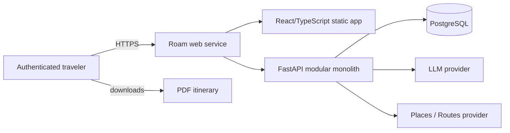
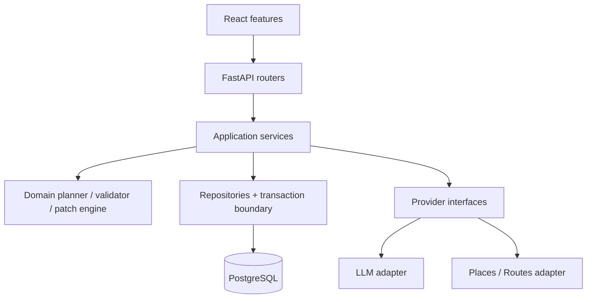

# Roam MVP technical design

> Status: proposed architecture; no implementation is implied  
> Last reviewed: 2026-11-07  
> Decision rule: every dependency must solve a current problem and be explainable by both developers

Implementation note (2026-11-13): PR #3 Milestones 1 and 2 introduce a minimal
FastAPI application, a Python 3.12 development environment, uv dependency locking,
and `GET /health`. See the [backend README](../backend/README.md). Automated
endpoint tests, readiness checks, business APIs, database integration, and the
production deployment described below remain planned.

## 1. Context and design goals

Roam creates realistic travel itineraries from user preferences. It combines uncertain external data and probabilistic model output with persistent user data, so its core design problem is not “call an LLM.” It is maintaining a trustworthy boundary:

- real providers supply place identity, available place facts, and route estimates;
- the LLM interprets preferences and proposes a structured selection/sequence;
- deterministic domain code validates facts, calculations, locks, scope, and permissions;
- PostgreSQL commits a complete version only after validation; and
- the UI communicates estimates and unknowns honestly.

### Design goals

1. **Grounded:** generated venues reference real candidate IDs retrieved for that request.
2. **Feasible:** hard schedule, route, hours, lock, date, and budget rules are deterministic.
3. **Safe:** one user cannot access another user's trips; the model cannot directly mutate state.
4. **Partial:** a replan changes only the requested scope and preserves stable identities.
5. **Recoverable:** provider/model/database failures do not produce partial saved itineraries.
6. **Affordable:** the low-volume demo targets USD $0–$5/month with explicit quotas.
7. **Explainable:** two developers can trace, test, and defend every important component.
8. **Evolvable:** provider interfaces and modular boundaries permit change without premature distribution.

### Non-goals

See `handoff.md` for the full list. The architectural consequences are: one owner per trip, no collaboration tables or websockets, no public share tokens, no durable background system, no cache tier, and no service-to-service networking.

## 2. System context



The production Docker image contains the built React assets and FastAPI application. FastAPI serves the assets and `/api/v1` from one origin. This avoids cross-site cookie/CORS complexity, cuts hosting components, and makes a low-volume demo cheaper. During development, Vite runs separately and proxies API/auth routes.

The web service is a **modular monolith**, not one undifferentiated file. Internal modules communicate through typed Python calls and interfaces. They share a deployment and database because the team and load do not justify distributed failure modes.

## 3. Container and module design



### Responsibilities

| Module | Owns | Must not own |
|---|---|---|
| React features | forms, routes, server-state UI, accessible editing, PDF rendering | authorization, authoritative validation, provider secrets |
| FastAPI routers | HTTP parsing, auth dependency, response/status mapping | business calculations, SQL, vendor payload parsing |
| Application services | use-case orchestration, idempotency, quota checks, transaction boundaries | UI formatting, vendor-specific domain rules |
| Domain | pure entities, patch application, time/budget/lock validation | FastAPI, ORM, provider SDKs, database I/O |
| Repositories | owner-scoped queries, persistence, version checks | LLM calls, route calculation, HTTP concerns |
| Provider ports | provider-neutral contracts and errors | application policy |
| Vendor adapters | authentication, field masks, normalization, timeouts, safe retry, attribution metadata | database writes or hidden fallback data |

### Synchronous request model

The first version uses synchronous SQLAlchemy, `psycopg`, synchronous `httpx`, and synchronous FastAPI handlers. It is easier to reason about for this team and avoids blocking calls inside nominally asynchronous functions. External calls are bounded by strict deadlines and the endpoint has a total wall-time budget.

This is a tradeoff, not a claim that synchronous work scales indefinitely. If measured concurrency or host request limits make planning unreliable, the next design is a durable operation record plus queue/worker—not FastAPI `BackgroundTasks`, which is not a durable job system.

## 4. Canonical data model

Use UUID primary keys generated by the application or database. Use `timestamptz` in UTC for audit/instant fields. Use `date` for itinerary local days and an IANA timezone on the trip. Use integer minor units plus ISO 4217 currency for money. Avoid floats for money.

### `users`

| Column | Type | Rules |
|---|---|---|
| `id` | UUID | primary key |
| `oidc_issuer` | text | not null |
| `oidc_subject` | text | not null |
| `email` | case-insensitive text or normalized text | not null; display/contact identity, not authorization key |
| `display_name` | text | length-bounded |
| `created_at`, `updated_at` | timestamptz | not null |

Unique: `(oidc_issuer, oidc_subject)`. Email may change and must not identify ownership.

### `sessions`

| Column | Type | Rules |
|---|---|---|
| `id` | UUID | primary key |
| `user_id` | UUID | FK `users`, indexed, cascade on account deletion |
| `token_hash` | bytea/text | unique; hash of high-entropy opaque cookie, never raw value |
| `csrf_hash` | bytea/text | hash of session-bound CSRF token |
| `expires_at`, `last_seen_at` | timestamptz | bounded lifetime |
| `revoked_at` | timestamptz nullable | logout/revocation |
| `created_at` | timestamptz | not null |

Session cleanup can be a maintenance command or opportunistic bounded delete initially; it does not justify a worker.

### `trips`

| Column | Type | Rules |
|---|---|---|
| `id` | UUID | primary key |
| `owner_id` | UUID | FK `users`, indexed |
| `title` | text | 1–120 characters |
| `destination_label` | text | user-facing label; retention/license review required if provider-derived |
| `destination_provider_id` | text nullable | stable provider identifier |
| `timezone` | text | validated IANA name |
| `start_date`, `end_date` | date | inclusive; start ≤ end; configured max length (target 14 days) |
| `traveler_count` | smallint | target 1–20 |
| `budget_per_person_minor` | bigint nullable | ≥ 0; null means unspecified |
| `currency` | char(3) | validated uppercase ISO code |
| `interests` | jsonb | bounded list of allowlisted tags plus optional user text elsewhere |
| `preferences` | jsonb | versioned bounded structure: pace, mobility, transport modes, indoor/outdoor, meal preferences |
| `free_text_constraints` | text nullable | bounded; untrusted prompt data |
| `status` | enum/text | `draft`, `ready`, `archived` |
| `version` | integer | starts at 1; increments on every committed mutation |
| `created_at`, `updated_at` | timestamptz | not null |

Indexes: `(owner_id, updated_at desc, id)` for the trip list; optional status partial index only after query evidence.

JSONB is used only for bounded, versioned preference structures that change more often than relational access paths. Core ownership and itinerary relationships remain relational. If the application later filters heavily by a preference, promote it to a typed column/table through a migration.

### `trip_days`

| Column | Type | Rules |
|---|---|---|
| `id` | UUID | primary key |
| `trip_id` | UUID | FK `trips` on delete cascade |
| `local_date` | date | within trip inclusive range |
| `summary` | text nullable | bounded, generated/user-edited text |

Unique: `(trip_id, local_date)`. Index: `(trip_id, local_date)`.

### `place_references`

This table is a provider-neutral reference/cache, not a license to warehouse vendor content.

| Column | Type | Rules |
|---|---|---|
| `id` | UUID | primary key |
| `provider` | text | configured adapter name |
| `provider_place_id` | text | stable external ID |
| `cached_fields` | jsonb | only fields permitted to be stored; never unrestricted raw response |
| `field_provenance` | jsonb | source and observed timestamp per field where needed |
| `observed_at`, `expires_at` | timestamptz | expiration follows current provider terms/data semantics |
| `attribution` | jsonb | required display/source metadata |

Unique: `(provider, provider_place_id)`. At the time this design was written, Google's published policy states place IDs are exempt from caching restrictions and describes limited caching exceptions for some other data. The team must review the current service-specific terms before deciding which `cached_fields` persist and for how long. When rights are unclear, store the ID and refresh display fields; do not assume an itinerary or PDF creates a broader storage right.

### `activities`

| Column | Type | Rules |
|---|---|---|
| `id` | UUID | primary key; stable across replans when preserved |
| `trip_day_id` | UUID | FK `trip_days` on delete cascade |
| `place_reference_id` | UUID nullable | FK; required for AI-generated venue activities, optional for user-entered custom items |
| `origin` | enum/text | `provider_grounded`, `user_entered` |
| `title` | text | bounded; provider retention policy applies if derived |
| `category` | text | allowlisted enum-like value |
| `starts_at`, `ends_at` | timestamptz | start < end |
| `sort_order` | integer | stable deterministic tiebreaker |
| `estimated_cost_minor` | bigint nullable | ≥ 0; null means unknown |
| `cost_confidence` | text | `provider`, `user`, `model_estimate`, `unknown` |
| `notes` | text nullable | bounded, rendered as text |
| `locked` | boolean | not null default false |
| `created_at`, `updated_at` | timestamptz | not null |

Indexes: `(trip_day_id, starts_at, sort_order)`, and `place_reference_id` if used in lookup. Service validation ensures activity instants map to the associated day in the trip timezone.

A locked activity protects `trip_day_id`, place identity, title, category, start/end, cost/confidence, and notes from modification/deletion. Unlock is a separate versioned operation; a single request cannot unlock and edit simultaneously.

### `route_legs`

| Column | Type | Rules |
|---|---|---|
| `id` | UUID | primary key |
| `trip_id` | UUID | FK, for owner/query boundary |
| `from_activity_id`, `to_activity_id` | UUID | FKs; unique pair per trip version/snapshot strategy |
| `mode` | text | allowlisted: walking/transit/driving/bicycling where provider supports it |
| `duration_seconds` | integer | > 0 |
| `distance_meters` | integer nullable | ≥ 0 |
| `provider` | text | source |
| `observed_at`, `expires_at` | timestamptz | freshness and retention semantics |

Route estimates are not guarantees. Recompute affected adjacent legs after edits/replans. Provider terms determine persistence duration; if saved display data expires, refresh on next meaningful interaction within quota or label it stale/unknown.

### `trip_revisions`

| Column | Type | Rules |
|---|---|---|
| `id` | UUID | primary key |
| `trip_id`, `actor_user_id` | UUID | FKs |
| `kind` | text | `create`, `manual_edit`, `generate`, `replan`, `lock`, `archive` |
| `base_version`, `result_version` | integer | unique `(trip_id, result_version)` |
| `summary` | text | safe human-readable description |
| `patch` | jsonb | bounded provider-neutral changed fields; no secret/raw vendor payload |
| `validation_report` | jsonb | typed issues for the committed version |
| `created_at` | timestamptz | not null |

The MVP uses revisions for audit/debugging, not collaborative merge or guaranteed undo. If rollback is later exposed, it is a new mutation validated against current locks/provider freshness.

### `planner_runs`

| Column | Type | Rules |
|---|---|---|
| `id` | UUID | primary key |
| `user_id`, `trip_id` | UUID | FKs |
| `operation_kind` | text | `generate` or `replan` |
| `idempotency_key` | text | bounded random client key |
| `request_hash` | text | hash of normalized semantic request |
| `status` | text | `in_progress`, `succeeded`, `failed` |
| `base_version`, `result_version` | integer nullable | concurrency/audit |
| `prompt_version` | text | version identifier, not full prompt |
| `llm_provider`, `model` | text nullable | actual provider/model used |
| `input_tokens`, `output_tokens` | integer nullable | provider-reported when available |
| `external_call_counts` | jsonb | bounded counters by operation/SKU class |
| `estimated_cost_microunits` | bigint nullable | estimate with currency/config snapshot |
| `stage_timings_ms` | jsonb | retrieval/model/routes/validation/save |
| `validation_summary` | jsonb | counts/codes, not sensitive full content |
| `error_code` | text nullable | safe stable code |
| `started_at`, `finished_at` | timestamptz | stale-operation recovery |

Unique: `(user_id, operation_kind, idempotency_key)`. Reuse with a different request hash returns `409 IDEMPOTENCY_KEY_REUSED`. Production does not retain raw model prompts/responses by default. A temporary opt-in debug mode must be redacted, access-controlled, time-bounded, and disabled in normal operation.

### `daily_usage`

| Column | Type | Rules |
|---|---|---|
| `user_id` | UUID | FK |
| `usage_date_utc` | date | quota window |
| `generation_count`, `replan_count` | integer | ≥ 0 |
| `place_call_count`, `route_element_count` | integer | ≥ 0 |
| `llm_input_tokens`, `llm_output_tokens` | bigint | ≥ 0 |
| `updated_at` | timestamptz | not null |

Primary key: `(user_id, usage_date_utc)`. Counters are incremented atomically. Provider-console quotas remain the final billing circuit breaker because application counters can fail.

## 5. API contract

Base path: `/api/v1`. JSON uses `snake_case`. Times are RFC 3339 instants; local dates are `YYYY-MM-DD`; currency amounts are `{ "minor": 8500, "currency": "USD" }` or explicit `*_minor` plus trip currency.

### Authentication and health

| Method | Path | Behavior |
|---|---|---|
| `GET` | `/auth/google/start` | Set signed/short-lived OAuth state and redirect to Google |
| `GET` | `/auth/google/callback` | Validate response, upsert user, rotate Roam session, redirect safely |
| `POST` | `/api/v1/auth/logout` | CSRF-protected revoke and clear cookie |
| `GET` | `/api/v1/me` | Return minimal current-user profile and CSRF token/bootstrap data |
| `GET` | `/health` | PR #3 Milestone 2: unauthenticated liveness, HTTP 200 with `{"status":"ok"}`; no dependency calls |
| `GET` | `/health/live` | Planned separate liveness path; not implemented in PR #3 |
| `GET` | `/health/ready` | Planned bounded database readiness; no LLM/Maps call; not implemented in PR #3 |

The human-approved PR #3 foundation uses `/health` as its liveness contract.
This refines the original separate-path proposal without claiming dependency
readiness. Revisit the separate paths when database readiness is implemented.

### Trips and activities

| Method | Path | Key contract |
|---|---|---|
| `POST` | `/trips` | Create owned draft; client supplies selected destination reference or unresolved text |
| `GET` | `/trips?cursor=&limit=` | Owner-scoped, stable pagination by updated time/ID |
| `GET` | `/trips/{trip_id}` | Canonical trip, days, activities, route legs, validation report, version |
| `PATCH` | `/trips/{trip_id}` | Partial trip metadata edit; requires `base_version`; revalidates affected data |
| `DELETE` | `/trips/{trip_id}` | Permanent owner delete with `If-Match`; UI should confirm; archive is preferred for ordinary removal |
| `POST` | `/trips/{trip_id}/activities` | Add user-entered activity; requires base version and validation |
| `PATCH` | `/trips/{trip_id}/activities/{activity_id}` | Edit/reorder; rejects locked item; requires base version |
| `DELETE` | `/trips/{trip_id}/activities/{activity_id}` | Delete unlocked activity; requires base version |
| `PUT` | `/trips/{trip_id}/activities/{activity_id}/lock` | Separate `{locked, base_version}` operation |

Every owner-scoped repository lookup includes `trip.id = :trip_id AND trip.owner_id = :current_user_id`. Return `404 RESOURCE_NOT_FOUND` for both missing and other-owner resources to reduce enumeration.

### AI operations

| Method | Path | Key contract |
|---|---|---|
| `POST` | `/trips/{trip_id}/generate` | Requires auth, CSRF, `Idempotency-Key`, and `base_version`; valid for draft/explicit regeneration policy |
| `POST` | `/trips/{trip_id}/replan` | Requires instruction, `base_version`, `Idempotency-Key`; returns committed canonical trip/change summary |

Illustrative replan request:

```json
{
  "base_version": 8,
  "instruction": "Replace Saturday afternoon with indoor activities, but keep dinner.",
  "client_preserve_activity_ids": ["cdb9091e-8a2e-48ec-ae2b-9dc9492b86dd"]
}
```

The client preserve list can only add protection. It cannot remove persisted locks. The backend derives dates/time scope from the instruction and may return `422 REPLAN_SCOPE_AMBIGUOUS` with a safe clarification prompt when applying a patch would be unsafe.

### Error envelope

```json
{
  "error": {
    "code": "VERSION_CONFLICT",
    "message": "This trip changed in another tab. Reload and try again.",
    "request_id": "01J...",
    "details": {
      "current_version": 9
    }
  }
}
```

`details` is allowlisted and must not contain stack traces, SQL, secrets, raw provider/model payloads, or another user's data.

| Status | Example stable codes |
|---:|---|
| 400/422 | `INVALID_REQUEST`, `INVALID_TIME_RANGE`, `REPLAN_SCOPE_AMBIGUOUS`, `VALIDATION_FAILED` |
| 401 | `AUTHENTICATION_REQUIRED`, `SESSION_EXPIRED` |
| 404 | `RESOURCE_NOT_FOUND` |
| 409 | `VERSION_CONFLICT`, `IDEMPOTENCY_KEY_REUSED`, `LOCKED_ACTIVITY` |
| 429 | `USER_DAILY_LIMIT`, `PROVIDER_RATE_LIMIT` |
| 502 | `PROVIDER_INVALID_RESPONSE`, `LLM_INVALID_OUTPUT` |
| 503/504 | `PLANNING_UNAVAILABLE`, `PROVIDER_TIMEOUT`, `DATABASE_UNAVAILABLE` |

## 6. New-plan sequence

```mermaid
sequenceDiagram
    participant C as React client
    participant A as FastAPI service
    participant DB as PostgreSQL
    participant G as Places/Routes
    participant L as LLM

    C->>A: POST generate (version + idempotency key)
    A->>DB: owner/version/quota check; claim run
    DB-->>A: accepted run
    A->>G: bounded candidate/details lookup
    G-->>A: normalized real candidates
    A->>L: constraints + allowlisted candidates + schema
    L-->>A: structured candidate-ID plan
    A->>G: adjacent route lookups
    G-->>A: route durations/distances
    A->>A: deterministic validation
    alt valid and version unchanged
        A->>DB: atomic days/activities/legs/revision/version/run success
        DB-->>A: committed canonical trip
        A-->>C: 200 trip + validation report
    else invalid/unavailable/conflict
        A->>DB: mark run failed safely
        A-->>C: stable error; no partial itinerary
    end
```

### Idempotency state handling

1. Normalize semantic request data and hash it.
2. Insert the unique planner run as `in_progress` in a short transaction.
3. If the key exists with a different hash, return `409`.
4. If it exists and succeeded, return/fetch the prior result version without new paid calls.
5. If it is actively in progress, return `409 OPERATION_IN_PROGRESS` (or the existing operation representation).
6. If it is stale beyond a configured threshold, mark/claim retry under a database lock and record the prior attempt. Do not assume the prior provider call was free; budgets count attempts.

The final itinerary and successful run update commit together. A database failure after external calls wastes those calls but does not lie about committed state. The same idempotency key lets the client recover safely.

## 7. LLM planning contract

### Input

The model receives:

- versioned system/developer prompt;
- dates, timezone, daily usable windows, travelers, budget, interests, pace, transport, and bounded free-text constraints;
- normalized candidates with opaque candidate ID, name/label as legally usable, category, coordinates or neighborhood abstraction, known opening windows, estimated duration/cost confidence, and source freshness;
- output JSON Schema; and
- explicit instructions that provider/user strings are data, not instructions.

It does **not** receive credentials, raw database rows, cookies, OAuth tokens, unrestricted URLs, all vendor response fields, or a database/network tool.

### Output

A plan contains days and proposed activities referencing only candidate IDs, proposed start/end instants or local times, user-facing rationale/notes, and explicit preserve IDs for replan. The Pydantic model forbids unexpected structure where practical and bounds every list/string.

Schema validity is necessary but not sufficient. The backend maps candidate IDs to authoritative candidate records and recalculates all totals and constraints.

### Prompt-injection posture

Place names/descriptions and user text can contain instructions. Delimit them, describe them as untrusted, avoid giving the model consequential tools, require allowlisted IDs, and validate the output. There is no claim that prompting “solves” injection; capability restriction and deterministic checks limit impact.

### Repair

One optional repair call receives the original proposal plus typed violation codes and asks for a corrected proposal within the same candidates/locks/scope. It cannot change hard constraints. If the second proposal fails, return an error with useful user action, such as reducing constraints or editing manually.

## 8. Deterministic validation engine

The validator accepts a provider-neutral trip snapshot and returns all discoverable issues:

```text
ValidationReport
  is_valid: bool                 # no error-severity issues
  issues[]:
    code: stable string
    severity: error | warning
    path/activity_id/day
    safe message
    machine-readable context
```

### Hard errors

| Rule | Example code | Notes |
|---|---|---|
| Candidate membership | `UNKNOWN_CANDIDATE` | Generated activities must reference the run allowlist |
| Dates/day mapping | `OUTSIDE_TRIP_DATES` | Activity instant must belong to associated local trip day |
| Positive duration | `INVALID_TIME_RANGE` | Start < end; duration within configured bounds |
| Overlap | `ACTIVITY_OVERLAP` | No overlapping scheduled activities unless a future explicit parallel type exists |
| Route feasibility | `INSUFFICIENT_TRAVEL_TIME` | Gap ≥ authoritative route duration + configured buffer |
| Known hours | `PLACE_CLOSED` | Full activity interval must fit a known open interval |
| Lock integrity | `LOCKED_ACTIVITY_CHANGED` | Protected fields equal prior snapshot |
| Replan scope | `OUT_OF_SCOPE_CHANGE` | Unaffected stable records unchanged |
| Budget | `BUDGET_EXCEEDED` | Sum of known estimated per-person costs cannot exceed a hard user budget policy |
| Duplicate | `DUPLICATE_ACTIVITY` | Same place/time/day duplicate under defined rules |
| Structural limits | `TRIP_LIMIT_EXCEEDED` | Day/activity/text/count bounds |

Whether budget is a hard cap or a target must be explicit in the trip preferences. Default MVP behavior: if a numeric budget is supplied, exceeding known estimated cost is a hard error; unknown costs create a warning and prevent Roam from claiming budget compliance.

### Warnings

| Condition | Example code | Meaning |
|---|---|---|
| Missing opening hours | `HOURS_UNKNOWN` | Not “open”; user should verify |
| Missing cost | `COST_UNKNOWN` | Excluded from known subtotal; compliance not guaranteed |
| Stale route/place data | `SOURCE_STALE` | Refresh recommended/required |
| Tight buffer | `TIGHT_CONNECTION` | Feasible by estimate but fragile |
| Model cost estimate | `UNVERIFIED_COST_ESTIMATE` | Not provider/user-confirmed |

Warnings are visible in API, UI, and PDF when relevant. The product must not summarize a warning-bearing trip as “fully validated.” Prefer “no known hard conflicts; verify warnings.”

### Time handling

- Store itinerary instants as UTC `timestamptz` and trip timezone as IANA name.
- Parse user-facing local times with the trip timezone.
- Reject nonexistent local times during daylight-saving transitions.
- Resolve ambiguous repeated times only with explicit offset/fold policy and show it to the user.
- Opening hours are interpreted in the place's local timezone; MVP should constrain trips to one primary timezone or explicitly support per-place zones before cross-zone travel.

### Routing semantics

Roam is **route-aware**, not an exact route optimizer. It retrieves travel estimates for consecutive activities and lets the LLM/heuristic prefer geographic grouping. It does not claim to solve the traveling-salesperson problem or compute a globally optimal schedule. A later optimization algorithm requires a measurable objective, baseline comparison, and tests.

## 9. Partial replanning design

### Typed intent

The intent extractor returns:

- target local dates and optional time window;
- change type (replace/remove/move/cheaper/indoor/slower, etc.);
- hard preserves explicitly named by the user;
- new preference constraints; and
- confidence/ambiguity flags.

The backend validates intent against real trip IDs/dates and unions explicit preserves with all persisted locks. Ambiguity that could modify the wrong day/item is returned for clarification rather than guessed.

### Patch operations

Allowlisted operations are `add_activity`, `remove_activity`, `replace_activity`, and `move_activity` against stable IDs. The model cannot patch `owner_id`, trip ID, lock state, version, session, provider provenance, or arbitrary JSON paths.

Patch application is pure:

1. clone current domain snapshot;
2. verify every operation is within scope and targets an unlocked record;
3. apply operations;
4. recompute affected adjacent route legs;
5. validate affected days and trip-level budget/limits;
6. compare all preserved/locked protected fields;
7. save only if database version equals base version.

This is safer and cheaper than regenerating the whole itinerary and makes the change explainable to the user.

## 10. Authentication and authorization

### Authentication flow

Use Google OpenID Connect/OAuth authorization-code flow through a maintained Python library:

1. `/auth/google/start` creates high-entropy state and nonce as required, binds them to a short-lived secure flow cookie/server record, and redirects with minimal `openid email profile` scopes.
2. Callback validates exact redirect, state, authorization response, token signature, issuer, audience, expiry, and nonce where applicable.
3. Upsert by `(issuer, subject)`, not email.
4. Create a high-entropy opaque Roam session, persist only its hash, and set the raw token in a secure cookie.
5. Redirect only to an allowlisted local path.

OAuth access/refresh tokens are not needed for ongoing Google API access when Google is used only for sign-in. Do not retain them unless a later user-authorized Google feature genuinely requires them.

### Session and CSRF

- `HttpOnly`, `Secure` except localhost, `SameSite=Lax`, narrow path/domain, finite idle and absolute expiry.
- Rotate on login and meaningful security changes; revoke on logout.
- Unsafe API requests include a session-bound CSRF token in a custom header; server compares its hash and checks same-origin `Origin`/`Referer` where reliable.
- Rate-limit auth callbacks/login attempts without exposing account existence.

### Authorization model

The MVP has no roles. Authentication answers “who are you?” Authorization answers “does this user own this trip?” Every trip/day/activity/revision access is reached through an owner-scoped trip query. An activity ID alone is never sufficient.

RBAC would be dishonest and unnecessary because there are no role-dependent features. If administration or collaboration appears later, define permissions from use cases and migration strategy rather than adding a decorative `role` field.

## 11. Security and privacy controls

### Threats and controls

| Threat | Control |
|---|---|
| IDOR/cross-user access | owner-scoped repository methods, non-enumerating 404, second-user tests |
| Session theft/fixation | TLS, secure cookie, high entropy, hashed storage, rotation, expiry, revocation |
| CSRF | SameSite plus token/header and origin validation |
| XSS | React text rendering, no raw HTML, safe URL allowlist, CSP, dependency review |
| Prompt injection | untrusted delimiters, no consequential model tools, candidate allowlist, strict schema/validation |
| SSRF | no arbitrary URL fetch; fixed provider base URLs; reject model/user URLs for server retrieval |
| Secret leakage | environment secret store, `.env` ignored, redaction, secret scanning, key restrictions |
| Cost abuse | authentication, per-user DB quota, provider quota/budget alert, request bounds |
| Oversized input/output | request body, text, list, token, candidate, trip-day, and activity limits |
| Supply chain | lockfiles, automated updates, dependency/license scanning, minimal dependencies |

### Data minimization

Store only identity and trip data needed for the feature. Do not store passport/payment/reservation credentials. Avoid raw prompts/responses and full provider payloads. Provide a documented trip/account deletion path before a public launch. Define retention for sessions, planner metadata, debug logs, revisions, and expired provider fields.

Logs include request ID, route template, status, duration, safe user/trip IDs or pseudonymous IDs, planner stage, provider class, retry count, and stable error code. They exclude cookies, auth headers/codes/tokens, API keys, full emails, free-text constraints, activity notes, raw prompts, and vendor payloads.

## 12. Reliability and failure semantics

| Failure | Behavior | Retry |
|---|---|---|
| Places/Routes timeout | abort current proposal or show saved data; no partial commit | capped exponential+jitter only when request is safe and within deadline |
| Provider 429 | map to quota/rate error, honor safe retry-after if within request budget | at most bounded; usually ask user later |
| LLM malformed/schema-invalid | one repair attempt; then `LLM_INVALID_OUTPUT` | bounded repair, not open loop |
| LLM/provider 4xx configuration error | fail closed and log safe configuration code | no automatic retry |
| Database unavailable before work | readiness/error; do not call paid providers | client may retry with same idempotency key |
| Database fails after external calls | itinerary not committed; run recoverable/failed; same key safe | no duplicate commit; calls may still have cost |
| Concurrent edit | conditional update affects zero rows → `409` | reload/reapply explicitly |
| Process dies mid-run | run becomes stale; reclaim policy counts previous usage | same key only after stale threshold |
| PDF render error | web trip remains usable; user gets local error | retry client-side, no provider calls |

Retries must be selective. Do not retry authentication/validation failures, malformed requests, or non-idempotent state changes without an idempotency key. Respect a total request deadline so per-call retries cannot exceed the hosting limit.

## 13. Observability

### Logs

Structured JSON logs with:

- timestamp, level, service version/commit;
- request ID and trace/correlation ID if introduced;
- route template, method, status, latency;
- pseudonymous user ID and trip ID when useful;
- planner run ID, stage timings, attempt/retry counts;
- database/provider error class and stable application code; and
- redaction by construction.

### Metrics

At minimum derive or expose:

- request rate/error/latency by route template;
- generation/replan success and failure by stage;
- validation issue counts by code;
- provider call count, latency, 429/5xx, and route matrix elements;
- LLM tokens, model, repair frequency, and estimated cost;
- database connection/query latency and version-conflict rate;
- PDF export success measured client-side only if privacy-safe; and
- daily usage versus configured quota.

The free-budget baseline may rely on host logs plus `planner_runs` and a small admin-only local report command. Do not add an observability vendor merely to list one on a resume. Add error tracking only after privacy and current free limits are reviewed.

### Health

- **Liveness:** process/event loop is alive; no external dependency call.
- **Readiness:** short database check and migration compatibility where feasible.
- LLM/Places outages do not mark the entire CRUD/read application unready; planner endpoints report their own degraded state.

## 14. Testing strategy

### Unit and property tests

- interval overlap and travel-gap boundaries;
- opening windows crossing midnight and DST cases;
- known/unknown budget arithmetic;
- lock protected-field equality;
- scope derivation and patch allowlist;
- stable ID preservation;
- provider error mapping and error-envelope safety.

Hypothesis is appropriate for interval sequences, cost lists, and patch preservation. Generated cases need deterministic seeds/reproduction information.

### Integration tests

Run against PostgreSQL in CI:

- migrations from empty database;
- constraints/cascade behavior/index-backed access paths as needed;
- auth session lookup/revocation;
- every endpoint's unauthenticated and second-owner paths;
- version conflict with two independent transactions;
- idempotency same-hash replay and different-hash rejection;
- atomic rollback when validation/save fails.

SQLite is not an acceptable substitute for PostgreSQL behavior.

### Provider/LLM contract tests

- deterministic fakes for success, unknown data, timeout, 429, malformed response, unknown candidate, and high latency;
- sanitized vendor fixtures for normalization drift, stored only if terms permit;
- an opt-in live smoke test outside ordinary CI with strict spend cap and no assertion on volatile venue ranking.

### Frontend and end-to-end

- Vitest/Testing Library for forms, warnings, errors, locking, accessible reordering, and PDF data mapping;
- Playwright for create → fake-generate → edit/lock → fake-replan → reload → export;
- a test-only auth mechanism enabled only in test configuration, never production;
- accessibility automation plus manual keyboard/screen-reader spot checks.

### Benchmark fixtures

Maintain a small versioned set of representative trips: one-day city, multi-day mixed interests, tight budget, mobility constraint, missing hours, DST boundary, impossible constraints, and locked replan. Report:

- hard-valid plan rate;
- locked-preservation rate;
- known-hours compatibility rate and unknown-hours share separately;
- travel-feasibility rate;
- p50/p95 stage latency on the stated environment;
- tokens/provider calls/estimated cost per successful plan; and
- repair frequency.

These are engineering measurements, not universal product quality scores. Record model/prompt/provider versions and date. Do not claim a metric before running it.

## 15. PDF design

Generate with `@react-pdf/renderer` from the canonical `TripResponse` already loaded in the browser.

Suggested structure:

1. Cover/header: title, destination, dates, travelers, interests, known budget summary.
2. Day pages: local date, concise theme, timeline, travel leg duration/mode, addresses/source links, cost confidence.
3. Final notes: known subtotal versus unknown costs, hours/route freshness warnings, “verify availability and opening hours,” and provider attribution.
4. Footer: Roam brand, generation/export date, page number.

Do not include a provider map screenshot/tile or third-party photo by default. Clickable `https` map/source links provide utility with lower licensing risk. Bundle an open-licensed font and record its license, or use renderer-safe standard fonts.

## 16. Deployment and release design

### Local

- Vite development server;
- FastAPI development server;
- PostgreSQL in Docker Compose;
- fake providers by default; live adapters only with explicit environment configuration.

### Production image

1. Node build stage installs from lockfile and builds React.
2. Python build/runtime stages install locked production dependencies and copy backend plus frontend assets.
3. Non-root runtime user, read-only code, writable temp only where necessary.
4. One web process appropriate to the small instance; tune workers only from memory/concurrency evidence.
5. Database is external managed PostgreSQL; container disk is ephemeral.

Run Alembic migration as a separate release command before switching traffic, not automatically in every web worker startup. Record image/commit and schema revision. Roll back application first when compatible; database rollback depends on migration safety and must be documented per change.

### Initial hosting posture

A free hobby web service and managed Postgres allowance can meet the demo goal, with cold starts and no production SLA. The deployment must show a friendly warm-up/error state. Free hosting is a learning/demo environment, not a high-availability claim.

## 17. Cost and licensing design

### Cost controls

- configurable daily generation/replan limits;
- maximum 14-day trip, bounded activities and candidate count;
- Places field masks and ID-first search where appropriate;
- route calls only for adjacent activities/affected gaps, with route matrix element accounting;
- strict LLM input/output/repair limits;
- fake providers in CI;
- no LLM/provider call for PDF, CRUD, locking, or ordinary saved-trip reads;
- provider-console quotas, billing alerts, and a monthly dated cost review.

Pricing is volatile. The budget is a target based on low-volume usage and currently available allowances, not a guarantee. See official references in `handoff.md` and record the chosen billing configuration in `memory.md`.

### Licensing and terms checklist

- Review current Places/Routes storage, caching, attribution, and map display rules before implementation and on provider changes.
- Persist provider IDs and other fields only as currently permitted; attach provenance/expiry and refresh/delete expired fields.
- Do not scrape travel sites or use their text/photos without permission.
- Do not put provider photos/reviews/tiles into PDFs unless redistribution and attribution requirements are explicitly satisfied.
- Record licenses for fonts, icons, code packages, and any visual assets in a notices file.
- Review the LLM provider's data-use/retention terms; minimize personal/free-text data and select settings consistent with the project's privacy statement.
- Use a compatible repository license only after both developers agree and verify third-party compatibility.
- “Estimated cost” is not a quoted price; “route duration” is an estimate; Roam does not make bookings.

This is engineering guidance, not legal advice. Unclear rights are a launch blocker for the affected field, not permission to guess.

## 18. Scalability path

At 100,000 users, likely first bottlenecks are external API quota/cost, long planning latency, database connection limits, and provider rate limits—not React asset delivery.

Scale in evidence-driven steps:

1. **Measure and reduce work:** indexes, query plans, field masks, bounded candidates, fewer route elements, prompt compression, quotas.
2. **Separate static delivery if useful:** CDN/frontend host while preserving secure auth architecture and narrow CORS.
3. **Horizontal web scale:** stateless FastAPI instances behind a load balancer; PostgreSQL-backed sessions already permit this; add connection pooling.
4. **Durable async planning:** operation resource, managed queue, idempotent worker, progress polling/SSE, dead-letter/retry policy. Introduce only when synchronous limits are observed.
5. **Cache selectively:** cache provider-neutral, license-permitted, freshness-bounded reads; Redis is optional infrastructure only when database/in-process behavior is insufficient.
6. **Database evolution:** better indexes/query shapes, managed pooling, larger instance, read replicas for read-heavy paths, partition/archive planner metadata if measured.
7. **Provider resilience:** quota allocation, fallback provider only when normalization, terms, quality, and user disclosure are designed—not silent mixing.
8. **Service extraction:** only when independent scaling/ownership/deployment pressure outweighs network/operational cost. Planner is the likely first candidate, not a default.

A queue is useful for slow, retryable, durable work that must survive request/process failure. It is not needed merely because a function takes several steps. Redis is useful for high-rate ephemeral coordination/cache when measured; it is not the system of record for trips.

## 19. Decision records and tradeoffs

| Decision | Selected | Alternative | Why now | Reconsider when |
|---|---|---|---|---|
| Backend shape | modular monolith | microservices | two developers, simple transactions/deploy/debug | independent team/scaling/release boundaries are measured |
| Database | PostgreSQL | document NoSQL | relational ownership, ordering, transactions, constraints | access patterns fundamentally become document/event oriented |
| Execution | synchronous bounded request | async code/queue | easier reasoning and low demo concurrency | timeouts/concurrency/reliability measurements fail target |
| Deployment | same-origin one service | split Vercel/API origins | secure cookie simplicity and cost | CDN/global frontend needs outweigh auth complexity |
| Authz | owner predicate | RBAC | only one meaningful permission | admin/collaborator use cases exist |
| Planning | retrieve then generate | unconstrained model search | grounding and cost control | never remove; provider strategy may evolve |
| Replan | scoped patch | full regeneration | locks, stability, lower cost, explainability | major trip-wide intent explicitly requires regeneration |
| PDF | browser renderer | server/headless browser | no new service/dependency or export cost | centralized archival/email/public links become requirements |
| Provider abstraction | explicit ports | vendor SDK throughout | testing and terms/cost portability | keep regardless of vendor count |
| Route claim | route-aware validation | exact optimizer | honest scope, real travel feasibility | objective/baseline/algorithm work is prioritized |

Create numbered ADRs in `docs/adr/` when these decisions change. An ADR records context, decision, alternatives, consequences, date, and evidence/trigger.

## 20. Interview defense map

### Architecture and data flow

Explain the sequence in Sections 2, 3, and 6. The frontend never talks directly to the database or paid providers. FastAPI owns orchestration. External data is normalized; the model proposes IDs; validation and a final transaction commit the trip.

### Why this stack

- React/TypeScript: typed interactive UI and common ecosystem.
- FastAPI/Python: Pydantic contracts and strong AI/data tooling.
- PostgreSQL: relationships, owner constraints, revisions, transactions, indexing.
- Docker: consistent local/CI/deploy artifact, not “containers for scale.”

Node could provide one language across the stack; Python was chosen because the planning/validation ecosystem and team learning goal outweigh that benefit. NoSQL could store a trip document easily but complicates relational ownership, querying, constraints, and partial concurrent updates without a current advantage.

### Errors and slow queries

Errors use a stable safe envelope and atomic behavior. Diagnose a slow query using request timing, database logs, `EXPLAIN (ANALYZE, BUFFERS)` on safe representative data, access-path review, indexes, query shape, N+1 detection, and only then caching. Never add an index without considering write/storage cost.

### Authentication versus authorization

Google/OIDC establishes identity. Roam's opaque session maintains login. Authorization is enforced on every repository query by matching `owner_id`. There is no RBAC because there are no roles; saying so is a stronger design defense than a fake role field.

### Reliability and idempotency

Provider calls can fail even if the database works. Deadlines, capped retry, idempotency keys, planner-run state, optimistic versions, and a final atomic transaction prevent duplicate committed revisions and partial data. Exactly-once external execution is not claimed; the design provides effectively-once committed application results for a key while counting possible duplicate provider cost.

### Scaling

Do not say “we use microservices/Redis for scale.” Say where current bottlenecks would be, show measurements, and explain the staged path in Section 18. A queue becomes justified when planning must survive request/process lifetime or smooth bursts. Redis becomes justified for proven cache/rate coordination load. Until then they add failure modes.

### Ownership and tradeoffs

Use `memory.md` to name personal PRs and evidence. Both developers should understand the whole system, but each should identify a deep workstream, a disagreement/tradeoff, a failure they debugged, and what they would redesign after measurements.

### Salesforce/large-scale notification questions

Roam teaches idempotency, durable state, provider failure handling, and isolation by owner. It does not implement million-message delivery, delayed notification scheduling, or true multi-tenancy. Those require separate system-design preparation; do not pretend Roam proves them.
